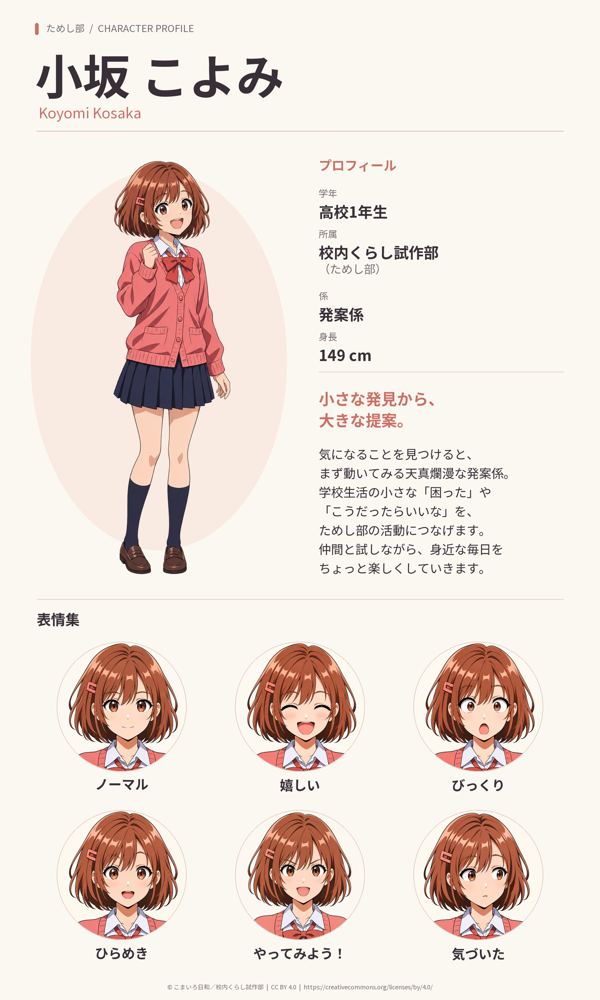

# 4コママンガのプロンプトと制作手順

『ためし部』と『瀬尾家』の制作を実例に、人物設定、4コマ脚本、作画、縦書き、部分修正、投稿用画像の準備をまとめた資料集です。検索できる冊子PDFと多言語版の作り方も扱います。

プロンプトを一度送って完成を待つだけでなく、試作を読んで修正し、採用稿を選ぶ工程を重視しています。画像生成AIを使い、作品を自分で確認しながら作りたい方を対象にしています。

**公開前レビュー版 2026年11月12日**。この一式はGitHubへの公開候補です。GitHubへの登録・アップロードは行っていません。

## 最初の4コマを作る

1. [準備と最短の手順](docs/quickstart.md)を読む。
2. [汎用プロンプト集](prompts/README.md)から「人物設定」「脚本」「作画」を順に使う。
3. [カラー4コマの制作手順](docs/color-workflow.md)に沿い、1本を試作する。
4. 文字・話者・小物を確認し、[修正プロンプト](prompts/05-local-edit.md)で必要な箇所を直す。
5. 採用した画像だけを投稿用へ書き出す。画像の完成と外部サイトへの投稿は別の工程です。

必要なものは、文章を扱えるAI、参照画像を渡せる画像生成・編集手段、文字と画像を配置できる編集環境です。特定サービスの契約やAPIを必須にはしていません。既存の作例は内蔵画像生成ツールを使った記録に基づき、個別のモデル名は断定していません。同じ文面でも生成結果は変わります。

## 実際の制作例

| 実例 | 学べること | 完成までの工程 |
|---|---|---|
| [1 こよみの人物紹介](examples/01-character/README.md) | 性格に合う表情、人物の同一性、設定画と組版 | 表情を個別生成し、立ち絵・紹介文と合成 |
| [2 役割分担](examples/02-roles/README.md) | 小物、話者、背景の描き込みと省略 | 全体試作から3コマ目の背景を局所修正 |
| [3 名前の長さ](examples/03-name/README.md) | 長文、縦書き、紙上の文字の向き | 作画後、長い紙の印字を別画像として変形・合成 |
| [4 満場一致](examples/04-unanimous/README.md) | 席順、俯瞰、地図の向き、塗りの回復 | 複数の修正指示と正常な色参照を使い分ける |

追加資料として、[瀬尾家の設定と制作例](series/seo/README.md)に三姉妹の設定画、リビング、ギャグ表現、4コマ「宿題の先生」の最新版を収録しています。

## 資料の案内

- [プロンプト一覧](prompts/README.md)：他作品にも使える編集済みテンプレート9本。
- [ためし部の設定](series/tameshibu.md)：主役4人、追加4人、季節と小物。
- [瀬尾家の設定](series/seo/README.md)：三姉妹、家庭内の服装と呼び方。
- [共通の作画方針](docs/art-direction.md)：通常版とギャグ表現、人物と背景の塗り分け。
- [文字と吹き出し](docs/lettering.md)：縦書き、発言順、紙上の印字。
- [検索できるPDF](docs/pdf-workflow.md)：冊子構成と検索可能な文字層。
- [翻訳と地域別編集](docs/localization.md)：会話とオチを保つ翻訳。
- [採用版と修正記録](docs/versioning.md)：参照画像、版、採用状態の管理。
- [出典と資料の読み方](docs/sources.md)：実使用文と編集済みテンプレートの区別。
- [ライセンス](LICENSE.md)：文章・プロンプト・脚本・収録画像はCC BY 4.0。第三者素材の条件は別途維持。
- [Releasesの公開と移行計画](releases/README.md)：アプリ用PDFとpixiv用画像の配布先・対象・公開状態。

## 作品と版を分ける

『ためし部』の冊子版はA5縦・右綴じ・8ページ、13本の4コマを収録する設計です。表紙と8ページはカラー、2〜7ページはモノクロが基本です。pixivリメイク版は1本1枚のカラー画像で、改稿した脚本と別の採用記録があります。両者を同じ完成版として扱いません。

『瀬尾家』は三姉妹の家庭での日常を描く別作品です。瀬尾凪は共通の人物ですが、妹や普段着を学校の漫画へ自動的に持ち込みません。『ためし部』のすみれと『瀬尾家』の澄は別人です。

## 完成作品と制作記事

- [ためし部の第1回をpixivで読む](https://www.pixiv.net/artworks/151828086)
- [マンガ制作記事の連載一覧](https://qiita.com/tyamada22/stocks/ea14e9a9d04ec8292263)
- [PDF改訂と配布を扱った記事](https://qiita.com/tyamada22/items/eee3433d069cbdd2db04)
- [旧PDF配布先 Viewer（将来廃止予定）](https://github.com/tyamada/MihirakiPDFViewer_Android/releases/tag/sample-manga-v2)
- [旧PDF配布先 Utility（将来廃止予定）](https://github.com/tyamada/MihirakiPDFUtility_Android/releases/tag/sample-manga-v2)

この資料集はPDFビューアアプリ本体を含みません。最新版のPDFと投稿用画像は、**この制作資料リポジトリのGitHub Releasesへ集約する計画**です。アプリ側の既存2つのReleaseは移行中の旧配布先で、将来廃止予定です。新しいReleaseの公開・検証と利用アプリの移行が終わるまでは旧URLを維持します。

現時点ではアプリ用PDFは旧配布先で公開済み、新しい配布先への51冊の移行とpixiv用画像24枚は公開予定です。新しいGitHubリポジトリとReleaseはまだ作成していません。[配布対象と移行手順](releases/README.md)を参照してください。

## ライセンス

本資料集は[CC BY 4.0](LICENSE.md)です。作者名と出典、ライセンスへのリンクを示し、変更があれば表示してください。アプリ本体や第三者フォントのライセンスは変更しません。

作者名：こまいろ日和 / Komairo Hiyori。作画・修正には生成AIを使用しています。最終的な採用判断は制作者が行います。
