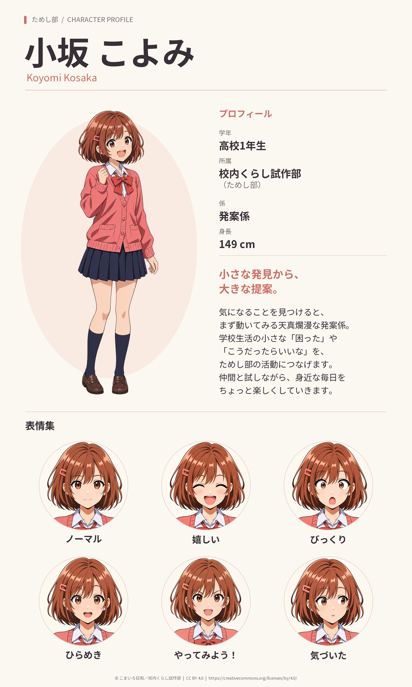
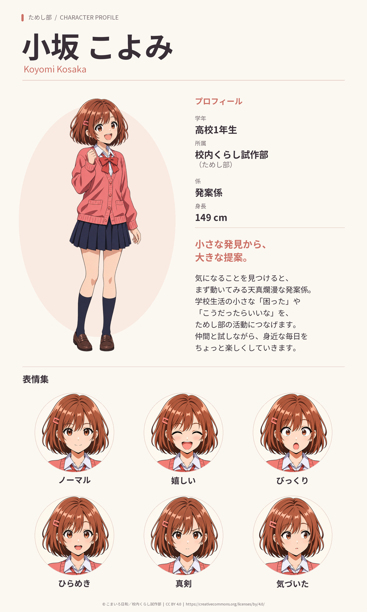

# 実例1 こよみの人物紹介

『ためし部』の小坂こよみの全身像、プロフィール、6表情をまとめた紹介画像です。採用版は2026年11月9日のv10で、1440×2400pxです。

## 性格に合う6表情を選ぶ

こよみは高校1年生、149cm、天真爛漫な発案係です。喜怒哀楽を均等にそろえるより、「見つける・思いつく・まず試す」という性格を表す表情を選びました。採用ラベルはノーマル、嬉しい、びっくり、ひらめき、やってみよう！、気づいたの6種類です。

人物は茶系のボブ、本人の右側に1本のコーラルの長方形ヘアピン、コーラルのカーディガンなどを基準とします。本人の右は正面の画像では読者の左です。

## 入力と工程

1. [立ち絵](assets/standing.png)と[初期表情](assets/expressions-initial.png)を同じ人物の参照にする。
2. [初期の生成指示](prompts/使用プロンプト_v1.json)で使われた人物条件を確認する。
3. ノーマルと喜び、嬉しいと驚き、ひらめきなどを個別に生成・編集する。
4. [v9の紹介](assets/before-v9.jpg)から「真剣」を「やってみよう！」へ差し替える。
5. [v10の実使用指示](prompts/使用プロンプト_v10.txt)で前向きな笑顔を作り、他の5表情を保持する。
6. 立ち絵、プロフィール、円形に配置した3列2段の表情、ラベル、権利表示を別の組版工程でまとめる。

## 画像生成だけでは行っていない部分

完成した紹介ページ全体を一度に生成したわけではありません。実制作では、生成した立ち絵と表情を画像処理で配置し、名前、紹介文、表情ラベルをフォントで描画しています。このパッケージには完成画像と主要な参照、保存されたプロンプトを収録しています。紹介ページを組み直す専用プログラムと全中間素材は含めていません。

v10の指示は「やってみよう！」の表情用です。ほかの表情も同時に完成する指示ではありません。v8などの途中の表情名を、そのまま採用ラベルと取り違えないでください。

## 確認と再利用

髪留めの本数・左右、頭の大きさ、服装、目線、表情とラベルの一致を確認します。「嬉しい」は目を閉じた喜び、「やってみよう！」は目を開いた前向きな意欲として分けています。

他作品では[表情テンプレート](../../prompts/02-expression.md)を使い、人物固有の性格から種類を選んでください。『瀬尾家』の[三姉妹資料](../../series/seo/README.md)では、通常表情と顔だけのギャグ表情を別資料として扱います。

## 原文を再利用するとき

収録した原文は当時の制作指示です。現在の設定・脚本・参照画像の役割を先に選び、原文の「image1」などを実際に添付するファイルへ対応付けます。新規制作では[文字を別工程にする手順](../../docs/lettering.md)へ置き換えられます。採用画像と同一の出力を保証するものではありません。

資料集と収録作例は[CC BY 4.0](../../LICENSE.md)です。完成画像一式は[このリポジトリのReleaseへ公開予定](../../releases/README.md)です。

## 紹介ページを組み直す場合

この例の主な入出力は「人物の参照 → 各表情 → 円形に切り抜く → 3列2段へ配置 → ラベルとプロフィールを入れる」です。実使用のプロンプトv10だけで6種類を同時に作り直す手順ではありません。ほかの5表情を既存稿から残す場合も、ラベルと画像の対応を確認します。

[収録ファイルと旧ファイル名の対応](references.json)を参照できます。制作記録に残る「未採用」はその途中版の状態で、最終採用版の説明ではありません。
