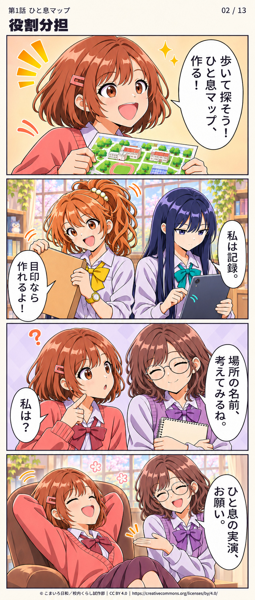
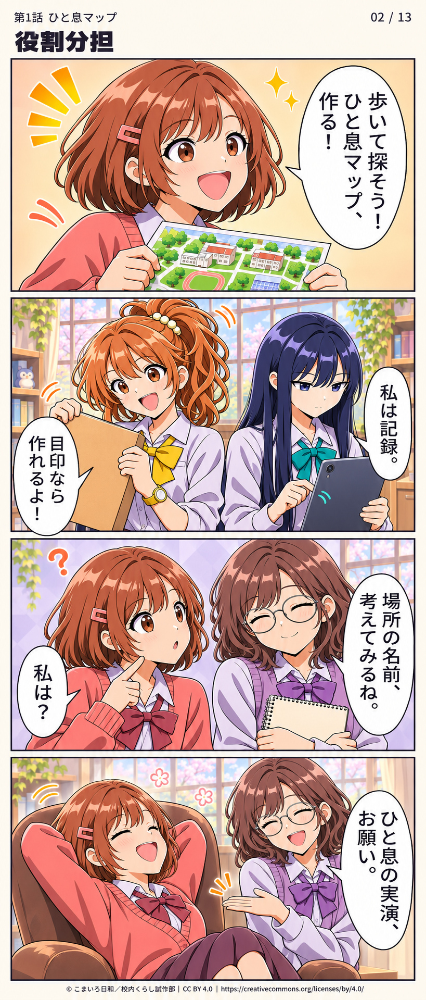

# 実例2 役割分担

公開作品：[pixiv](https://www.pixiv.net/artworks/151867715)。投稿完了はユーザー報告と提供URLに基づき、ページ本体はサイト制限により直接確認していません。[公開記録](../../releases/pixiv-publication-status.md)。

『ためし部』第1話「ひと息マップ」のNo.02です。2026年11月11日の試作v1を修正し、背景を整理したv2が採用されています。

## 話と画面の狙い

こよみが地図作りを提案し、凪は記録、くるみは目印、すみれは名前を担当します。こよみの担当を尋ねると、すみれが「ひと息の実演、お願い。」と返します。確定文言と話者は[脚本](script.json)に収録しています。

人物と小物の参照から全体を試作し、2コマ目では記録に使うタブレットを見せ、3コマ目では会話へ視線を集める構成です。

## 参照と実使用指示

元の実使用指示はimage1を人物・セリフ・小物、image2を同じ部室・線・色の基準としています。当時のimage1は投稿用ファイルを参照しており、そのファイルは後に採用画像へ更新されています。当時の同一ファイルを復元できるとは扱いません。

この一式では[11月8日v8の人物参照](assets/identity-reference.jpg)を再利用の補助に添えています。当時のimage1と同一とは断定しません。[部室の参照](assets/room-reference.jpg)はNo.01の試作です。原文の添付番号は、現在添付するファイルに合わせて説明し直してください。

1. [全体試作の指示](prompts/使用プロンプト_v1.txt)でv1を作る。
2. 3コマ目に窓・植物の断片が残っていることを確認する。
3. [背景修正の指示](prompts/使用プロンプト_v2.txt)で、人物・セリフを保持しながら背景を淡いラベンダーの幾何学模様へ統一する。
4. 全4コマを読み、v2を採用する。

## 小物の確認

凪のタブレットは、背面の縦持ちで読者から見て左上にカメラ、その直下に小さな消灯中のLEDを置きます。横持ちの場合も持ち方と見える面を指定します。メーカー名やロゴは使いません。

人物基準は髪型、髪留め、眼鏡、服装です。途中の実使用文に「skirt」の色などの表記揺れがあっても、その語だけで最新設定を変えず、指定した参照画像を優先します。

## この修正から使える方法

背景を省略する指示は「薄くする」だけでなく、「残す物」「取り除く物」「端まで埋める範囲」を書きます。前後のコマで場所が分かれば、会話中心のコマを簡略化できます。修正後は背景だけでなく人物と文字も確認します。

[部分修正テンプレート](../../prompts/05-local-edit.md)と[制作記録v2](records/制作記録_v2.json)を参照してください。

## 原文を再利用するとき

収録した原文は当時の制作指示です。現在の設定・脚本・参照画像の役割を先に選び、原文の「image1」などを実際に添付するファイルへ対応付けます。新規制作では[文字を別工程にする手順](../../docs/lettering.md)へ置き換えられます。採用画像と同一の出力を保証するものではありません。

資料集と収録作例は[CC BY 4.0](../../LICENSE.md)です。完成画像一式は[このリポジトリのReleaseへ公開予定](../../releases/README.md)です。

[収録ファイルと旧ファイル名の対応](references.json)を参照できます。制作記録に残る「未採用」はその途中版の状態で、最終採用版の説明ではありません。
