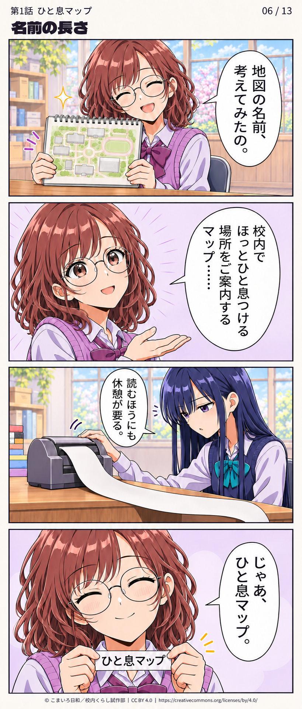

# 実例3 名前の長さ

『ためし部』第1話のNo.06です。すみれが考えた長い名前を、ラベルプリンターの長い紙と短い名前の対比で見せます。2026年11月11日の採用稿です。

## 脚本

1. すみれ「地図の名前、考えてみたの。」
2. すみれ「校内でほっとひと息つける場所をご案内するマップ……」
3. 凪「読むほうにも休憩が要る。」
4. すみれ「じゃあ、ひと息マップ。」

[機械可読の脚本](script.json)も収録しています。

## 入力と実際の工程

1. [11月9日v4](assets/reference-nov09.jpg)を人物・小物・紙の扱いの参照にする。
2. [全体試作の指示](prompts/使用プロンプト_v1.txt)で、長い吹き出し、プリンター、短いラベルの対比を作る。
3. [印字方向の修正指示](prompts/印字方向修正プロンプト_v1.txt)で、凪から読める印字の向きを明確にする。
4. 作画後の[印字合成前原稿](assets/art-before-print.png)へ、フォントで描いた長い名前を別画像として配置する。
5. 紙の上下縁に沿って文字を変形し、凪側から読めるように局所座標の両軸を反転する。
6. 180度回転した確認表示でも文字列を読み、全体のセリフを照合して採用する。

## 文字の向きと曲面

読者からは逆さでも、机の向こう側にいる凪が読める向きにします。原文の「3D texture-mapping」は見た目を伝える指示です。実制作では3Dモデルを作らず、画像内の紙の上下縁を座標で近似し、文字画像を変形しています。

実制作の[印字マスク](assets/print-layer.png)は白字・黒背景です。黒を透明、白をインクの濃さとして使い、原稿に暗い文字を合成しています。完成画像と同じ位置にそのまま貼るための透明PNGではありません。

## 手作業で再現する

縦書き対応の画像編集ソフトなどで、長い名前を横1行の独立した文字レイヤーとして作ります。紙の面に沿って回転・遠近・変形を調整し、凪から読める向きにします。紙の曲がり方に対する文字の縮みを確認し、前後のコマを含めて出力します。

元の専用配置処理は特定の画像と座標、フォントに依存していたため、そのまま動く汎用ツールとしては収録していません。[配置の仕様](print-placement.json)に元座標と文字列を保存しています。別の画像では座標を測り直してください。

## 確認の限界

この手法は紙の縁からの近似で、厳密な3D曲面の再構成ではありません。文字を正確に打てても、紙の遠近と読みやすさは画像で確認します。吹き出しは縦書き、紙のラベルは横書きという違いも維持します。

[文字と吹き出しの手順](../../docs/lettering.md)と[制作記録](records/制作記録_v1.json)を参照してください。

## 原文を再利用するとき

収録した原文は当時の制作指示です。現在の設定・脚本・参照画像の役割を先に選び、原文の「image1」などを実際に添付するファイルへ対応付けます。新規制作では[文字を別工程にする手順](../../docs/lettering.md)へ置き換えられます。採用画像と同一の出力を保証するものではありません。

資料集と収録作例は[CC BY 4.0](../../LICENSE.md)です。完成画像一式は[このリポジトリのReleaseへ公開予定](../../releases/README.md)です。

## 配置座標の基準

[配置仕様](print-placement.json)の座標は819×1920pxの元原稿用です。左上が原点、xは右、yは下へ増え、各組は「x、紙の上縁y、下縁y」を表します。元サイズで配置してから縮小するか、新しいサイズで座標を測り直します。画像を回転・トリミングした後へ同じ座標を使わないでください。

[収録ファイルと旧ファイル名の対応](references.json)を参照できます。制作記録に残る「未採用」はその途中版の状態で、最終採用版の説明ではありません。
