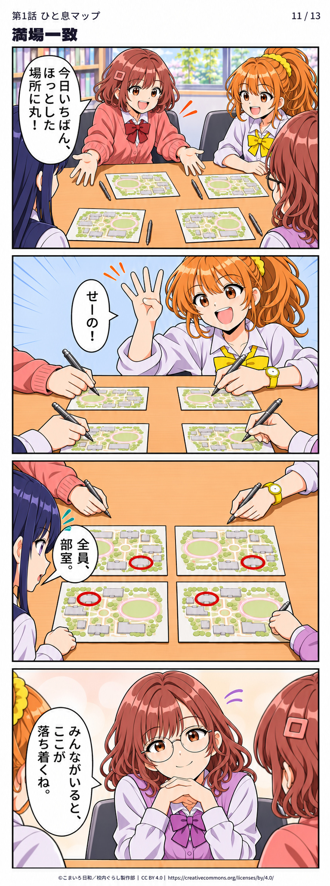
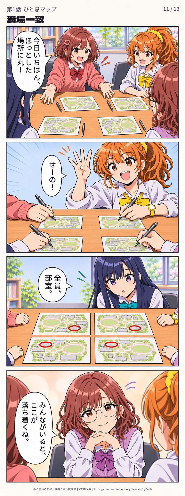
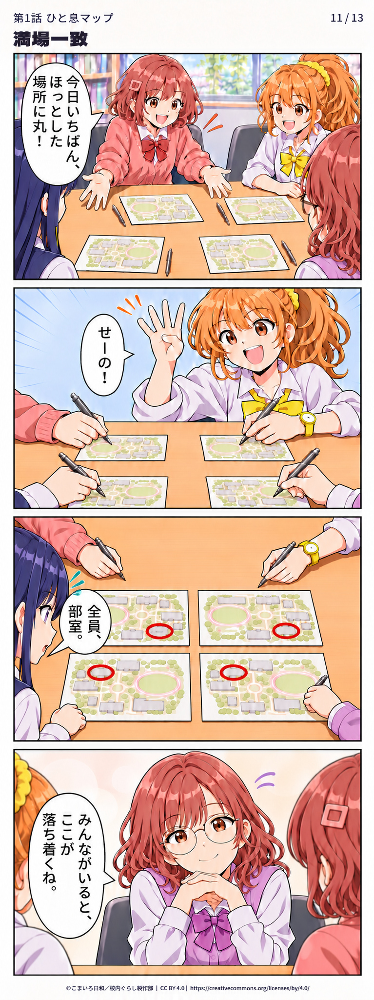

# 実例4 満場一致

『ためし部』第1話のNo.11です。4人がそれぞれの地図に丸を付けると、全員が同じ部室を選んでいた、という話です。2026年11月11日の採用稿はv3です。

## 席順と地図の向き

1コマ目の基準では、奥左こよみ、奥右くるみ、手前左凪、手前右すみれです。地図は各人が読めるように置き、奥の2枚は手前の2枚に対して180度回転しています。

3コマ目は4枚の地図と4つの赤丸を示します。手前の地図では運動場が右、丸が左上、奥の地図では運動場が左、丸が右下になるよう指定しました。4コマ目はカメラが窓側へ変わるため、左くるみ、中央すみれ、右こよみの並びになります。全体の鏡像反転ではなく、視点と人物の対応を直します。

## 試作から採用まで

| 段階 | 問題と作業 | 画像 |
|---|---|---|
| 11月9日の参照 | 人物、脚本、地図の題材を引き継ぐ | [参照v4](assets/reference-nov09.jpg) |
| v1 | 凪の顔と手の位置、4コマ目の左右などを確認 | [試作v1](assets/before-v1.jpg) |
| v2 | 席順、顔と手のつながり、赤丸、吹き出しを調整 | [配置修正版v2](assets/before-v2.jpg) |
| v3 | v2の構図を保ち、v1の正常な線と色を参照して彩色を回復 | [採用v3](assets/adopted.jpg) |

## 保存されている実使用指示

- [全体試作](prompts/使用プロンプト_v1.txt)
- [地図の向き](prompts/地図方向修正プロンプト_v1.txt)
- [凪の位置](prompts/配置修正プロンプト_v2.txt)
- [俯瞰の画面](prompts/俯瞰構図修正プロンプト_v2.txt)
- [席順と赤丸](prompts/席順・赤丸修正プロンプト_v2.txt)
- [赤丸の数](prompts/赤丸数修正プロンプト_v2.txt)
- [吹き出し](prompts/吹き出し修正プロンプト_v2.txt)
- [人物の線と色の回復](prompts/着色修正プロンプト_v3.txt)

同じv2名の複数指示は、保存された修正内容の一覧です。各指示に対応する中間画像がすべて存在するわけではなく、この一覧だけから厳密な実行順や回数を断定しません。

彩色回復ではimage1をv2の構図、image2をv1の線・色と明示しています。人物の位置までv1へ戻さないようにすることが要点です。

## 確認と残る制約

記録では、4人、地図4枚、赤丸4個、凪の顔と手、吹き出しの距離、4コマ目の左右を確認しています。地図の建物の細部は生成画像ごとに差があり、完全一致の地図素材ではありません。厳密に同じ場所を示したい場合は、共通の地図画像を4枚へ変形配置する工程を追加します。

[確定脚本](script.json)、[制作記録v2](records/制作記録_v2.json)、[制作記録v3](records/制作記録_v3.json)、[彩色回復テンプレート](../../prompts/07-color-repair.md)を参照してください。

## 原文を再利用するとき

収録した原文は当時の制作指示です。現在の設定・脚本・参照画像の役割を先に選び、原文の「image1」などを実際に添付するファイルへ対応付けます。新規制作では[文字を別工程にする手順](../../docs/lettering.md)へ置き換えられます。採用画像と同一の出力を保証するものではありません。

資料集と収録作例は[CC BY 4.0](../../LICENSE.md)です。完成画像一式は[このリポジトリのReleaseへ公開予定](../../releases/README.md)です。

[収録ファイルと旧ファイル名の対応](references.json)を参照できます。制作記録に残る「未採用」はその途中版の状態で、最終採用版の説明ではありません。
