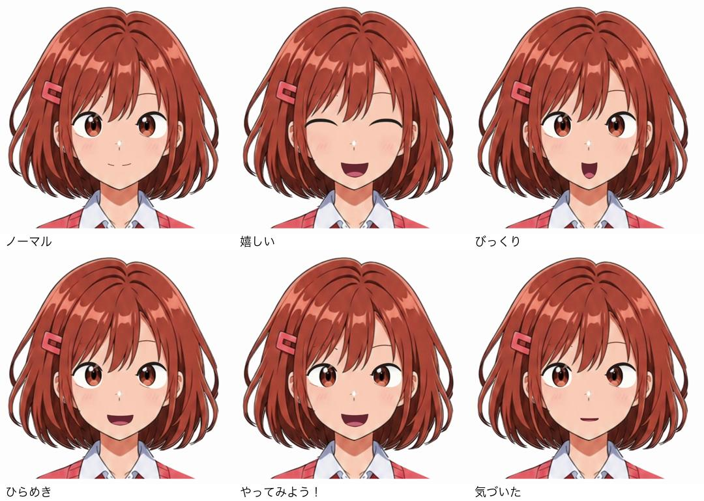

# こよみ Live2Dモデル

『ためし部』の小坂こよみのLive2D制作データ **v31** です。v30の正面・音声同期・6表情・眉角度・髪揺れを保ち、**斜め向きを調整し、まばたき中に閉じ口の線が再表示される問題を修正**しました。45〜80度の大きな横顔は未完成です。

[音声付き確認動画（30秒）](preview/showcase-30s.mp4) · [無音版](preview/showcase-30s-silent.mp4) · [視線・閉眼・笑顔目の動画](preview/gaze-check.mp4) · [視線の比較画像](preview/gaze-comparison.jpg)

音声：**VOICEVOX:春日部つむぎ**。最初の約9秒が自己紹介、続いて6表情を比較します。動画の音声・映像を別々にずらす同期補正は行っていません。

[モデル・PSD・CMO3・確認動画のZIP](https://github.com/tyamada/manga-prompt-kit/releases/tag/koyomi-live2d-v31-20261124)

## 再生・編集

1. Cubism Viewerで [`runtime/koyomi.model3.json`](runtime/koyomi.model3.json) を開きます。SDK 5.3対応です。
2. `motions > HairStrandsCheck` は6毛束の個別確認、`motions > Showcase` は30秒の自己紹介動作と6表情、`GazeCheck` は上下左右・斜めの視線と閉眼・笑顔目、`BrowCheck` は左右の眉、`MouthCheck` は通常・笑顔・驚きの口開閉、`BrowAngleCheck` は左右の眉角度、`HeadTurnCheck` は左右向きと上下・口・まばたきの組合せ確認です。配布モデルは無音です。[音声を自分の環境で追加する手順](audio/README.md)を参照してください。
3. `Showcase` と `PhysicsCheck` は**物理演算をオン**にします。`HairStrandsCheck` は直接パラメータを動かすため**物理演算をオフ**にします。自動目パチ・カーソル追従・呼吸・アイドリングモーションと手動表情は解除してください。別版の確認ウィンドウを閉じると描画負荷を減らせます。
4. 手動の `expressions` ではノーマル・嬉しい・びっくり・ひらめき・やってみよう！・気づいたを選べます。表情を有効にし、モーションを停止して切り替えてください。表情設定は口の開閉値を上書きしないため、音声の口開閉と併用できます。
5. 編集は [`source/koyomi-v31.cmo3`](source/koyomi-v31.cmo3) をCubism Editorで開きます。原画は [`source/koyomi-v31.psd`](source/koyomi-v31.psd)（35層）と分割PNG・SVGです。追加笑顔目のみのPSDと、髪7パーツだけのPSD・分割PNGも保存しています。PSDは首側の重複顎線のみを修正しました。以前のCMO3は履歴参照用です。

## v31の斜め向きと目パチ・口の分離

[顔向きと口・まばたきの実行動画](preview/head-turn-check.mp4) · [比較画像](preview/head-turn-comparison.jpg)

左右向きの端点で顔の中心線を段階的に移し、斜め向きを強めました。正面の形状・既存の30秒モーション・音声原本・6表情・髪物理演算はv30と同じです。首素材から重複顎線を除去し、PSD35層のうち他34層は描画内容・位置・可視状態が同一です。顔向きによる変形そのものは変わるため、既存の小振幅シーンも再収録しました。

組合せ検証で、v30以前の閉じ口パーツに左目開閉のキーが入り、閉眼中に口を開けても線が再表示される問題を発見しました。閉じ口からこの誤った連動を外し、開閉0.1以上では閉眼中も非表示にしました。Xの5段階・Yの3段階・口開閉4段階・口形3種・閉眼/開眼の360条件で確認し、新たな三角形の反転はありませんでした。

`HeadTurnCheck`のX±30・Y±8はパラメータ値で、実際の顔の角度ではありません。正面原画の斜め向き調整であり、45〜80度の横顔、鼻の外形・遠い側の目の隠れ方と専用の途中原画は今後の工程です。

45〜80度用の[専用原画候補（v32・制作途中）](development/v32-profile-art/README.md)を追加しました。未分割・未リグで、配布用モデルはv31のままです。

## v30の眉角度（維持）

[左右単独の角度確認動画（v30）](preview/brow-angle-check.mp4) · [比較画像](preview/brow-angle-comparison.jpg)

`ParamBrowLAngle` / `ParamBrowRAngle`を追加しました。左右は本人基準、各-1〜1・初期値0・回転約±6度です。各項目は対応する眉だけを動かし、目・口・髪等は動かしません。既存の眉上下・共通表情と併用できます。嬉しいはわずかに内側を上げ、ひらめき・気づいたは片眉の差、やってみよう！は内側を控えめに下げています。右眉は前髪に隠れる部分があります。

元の自己紹介9.6秒までは追加角度0で、v29の既存モーション曲線・音声原本は保持しています。追加した親変形により、角度0の眉位置には確認した顔向きで最大約0.33原画pxの差があります。眉以外の形状・表示は代表条件でv29と一致しました。音声・映像を別々にずらす補正は行っていません。v30の推定口遅れは約30ms（30fps測定の誤差約33ms）、肩の移動は0pxでした。

## v29の口表示修正（維持）

[口だけの実行確認動画（v29）](preview/mouth-check.mp4) · [口形の比較画像](preview/mouth-comparison.jpg)

- v28では閉じ口の線が開閉0.2で60%、0.4で20%残っていました。v29では0〜0.1の短い切替区間で消し、0.1以上では表示しません。
- 元の通常口・丸い驚き口は水平でしたが、笑顔の変形に約13原画pxの口角差がありました。意図された非対称という承認記録はなく、笑顔に応じた親回転で約1pxまで揃えました。測定は正面・全開・原画1024px換算、精度約1pxです。
- 正面の通常口・驚き口の形は維持しています。親回転の追加により、確認した顔向きの組合せでは口の位置に最大約2.2原画pxの差があります。口以外の形状・表示率は84条件でv28と一致しました。
- 音声原本・30秒モーション・6表情設定・物理演算・テクスチャはv28と同一。音声付き実行動画を再収録し、口の推定遅れは約26ms（30fps測定の誤差約33ms）、肩の移動は0pxでした。動画の音声と映像を別々にずらしていません。

## 目・表情・眉と髪揺れ

- `ParamEyeBallX/Y`：虹彩・瞳孔・ハイライトを両眼一緒に移動します。白目・まぶた・顔は固定し、既存の閉眼制御を保持しています。
- `ParamEyeLSmile`：左右共通の専用笑顔目を制御します。左目だけの制御ではありません。使用時は両眼の `ParamEyeLOpen/ROpen` を0にします。収録した嬉しい表情では自動的に設定します。
- 嬉しいは笑顔目、びっくりは丸い口と上がった眉、ひらめきは上向きの視線、やってみよう！は少し下げた眉と笑顔、気づいたは横への視線と小さな口で違いを付けています。既存の共通眉制御に、左右独立の小さな上下差を加えました。ひらめき・気づいたでは片眉を少し高くし、嬉しい・びっくりでは両眉を控えめに上げています。
- 髪は固定の頭頂部と可動6毛束に分割。`ParamHairOuterL/SideL/BangC/BangR/SideR/OuterR`（各-1〜1、初期値0）で個別に動きます。左右は本人基準です。根元を抑え、既存の頭部変形・全体髪揺れに追従させています。
- `Showcase` は顔・音声・6表情をモーションで、6毛束を物理演算で動かします。個別毛束の焼き込み曲線を外し、二重制御を避けました。
- `PhysicsCheck` は顔だけを動かす21秒の確認モーションです。[物理演算オン](preview/physics-on.mp4)・[オフ](preview/physics-off.mp4)・[比較画像](preview/physics-comparison.jpg)を保存しました。停止後の控えめな髪の収束を確認できます。比較動画は物理演算設定が同じv27の記録です。
- [毛束別の実行動画](preview/hair-strands-check.mp4)と[視線動画](preview/gaze-check.mp4)は眉の追加調整が0の状態に相当するv26記録を保持しています。`HairStrandsCheck` は物理演算オフで1本ずつ直接動かします。
- `ParamBrowLAdjustY/RAdjustY`（本人基準、各-1〜1、初期値0）は左右の眉だけを約7原画px上下させる追加調整です。既存の共通眉制御は維持しています。[左右単独確認動画](preview/brow-check.mp4)と[比較画像](preview/brow-comparison.jpg)は上下調整を追加したv28の記録です。右眉は前髪に隠れる部分があります。
- 大きな横顔、眉の独立した形状、体・リボン・手の演技、VTube Studio追従は未完了です。

[実機確認記録](verification/v31-runtime.json) · [制作記録](docs/production.md) · [全体計画と残作業](docs/roadmap.md) · [開発資料](development/README.md)

## フォルダー構成と利用条件

| フォルダー | 内容 |
| --- | --- |
| `runtime/` | MOC3・物理演算・設定・テクスチャ・モーション・6表情。一式で利用 |
| `source/` | 編集CMO3・PSD・分割PNG/SVG・レイヤー一覧 |
| `audio/` | セリフ・調声設定・利用者の環境での音声追加手順 |
| `preview/` | モデル部分だけの確認動画・比較画像。旧版の記録も保持 |
| `verification/` | 実機検証・容量・SHA-256 |
| `development/` | 大きな横顔・旧毛束試作・全身・手の制作途中資料 |

独自のモデル・素材・文書・動画の映像部分は[CC BY 4.0](LICENSE.md)。**合成音声は対象外**で、VOICEVOXおよび春日部つむぎの規約に従います。[クレジットと利用条件](docs/credits.md)を確認してください。単体WAV、個人パスが映る全画面録画、SDK本体は配布しません。
