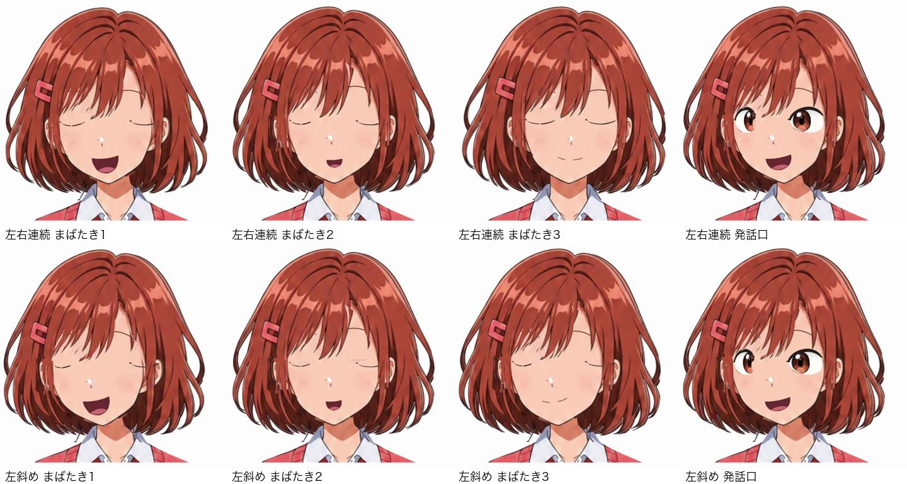

# こよみ Live2Dモデル v38

『ためし部』小坂こよみの**採用音声Iを反映したv38**です。確認済みv36の顔立ち・左右上下の顔向き・傾き・まばたき・口・6表情・髪揺れを保持しています。右80度の独立試作v37は統合していません。

[採用音声I付き30秒](preview/showcase-30s.mp4) · [無音版](preview/showcase-30s-silent.mp4) · [左斜め・音声付き](preview/showcase-l45-30s.mp4) · [左斜め・無音版](preview/showcase-l45-30s-silent.mp4)

音声：**VOICEVOX:春日部つむぎ**。最初の約9秒が自己紹介、後半が6表情です。動画と音声を別々にずらす同期補正や収録後の音声差し替えはありません。待ち時間は映像と音声を一緒にカットしました。

[モデル・PSD・CMO3・確認動画の配布ZIP](https://github.com/tyamada/manga-prompt-kit/releases/tag/koyomi-live2d-v38-20261125)

## 再生・編集

1. Cubism Viewer（SDK5.3対応）で [runtime/koyomi.model3.json](runtime/koyomi.model3.json) を開きます。配布モデルは無音です。
2. 自動目パチ・カーソル追従・呼吸・アイドリング・手動表情を解除し、パラメータを初期値へ戻します。髪の物理演算をオンにして `ShowcaseBoth`（左右連続）または `ShowcaseL45`（左斜め）を再生します。
3. 手動表情は6種類。`HairStrandsCheck`の直接駆動検査では物理演算をオフにします。
4. 編集原本は [CMO3](source/koyomi-v38.cmo3)、原画は [39層PSD](source/koyomi-v38.psd)。[層一覧](source/layers.json)と追加用素材も同梱しています。
5. 自分の環境で音声を加える場合は [採用Iの調声JSONと手順](audio/README.md)を使用してください。単体WAVは同梱しません。

## 確認した範囲

口と音声の測定差は左右連続・左斜めとも約0.012秒（30fpsの1フレーム約0.033秒以内）。肩4領域の移動0px。採用Iの録音との相関は0.997／0.994。[連続シーン検査](verification/both-video-verification.json)・[左斜め検査](verification/l45-video-verification.json)。

採用Iは元の音声と音素長・間・総サンプル数が同一で、既存の動作曲線を維持しました。アトラス配置済みの確認済み編集原本から再出力し、MOC3・PNG・物理JSONの完全一致も確認しています。[編集原本の再出力](verification/editor-roundtrip.json)・[採用と保持の記録](verification/v38-adoption.json)。測定には録画フレーム間隔などの限界があります。

45度は作画上の目安で、物理角度の計測値ではありません。80度への移行と同角度での自然な開閉・6表情、全身・手・VTube Studio追従は残作業です。旧版はリポジトリ履歴と過去Releasesに保持しています。

## 利用条件

独自モデル・編集素材・画像・モーション・調声設定・文書・動画の映像部分は、権利の存在と保有の範囲で **CC BY 4.0**。**合成音声は例外**で、音声付き動画全体をCC BY 4.0のみで再利用できると解釈しないでください。[利用条件](LICENSE.md)・[クレジット](CREDITS.md)。無音版も同梱。単体WAV・個人パスが映る全画面録画・SDKやアプリ本体は含みません。

## 右80度の開発版 v39

[右80度のまばたき・口の途中形状を改善した開発版](development/v39-right80-continuous/README.md)を保存しました。採用音声Iと既存6表情を保持していますが、45度→80度の接続中に二重輪郭が残るため、通常配布のv38は維持します。確認動画・編集原本・実行モデルと未解決フレームを同梱。単体WAV・全画面録画は含みません。

## v40：右80度への表示切り替え

[v40の実行モデル・編集原本・確認動画](development/v40-right80-switching/README.md)を追加しました。v38の顔立ち・採用音声I・既存6表情とv39の開閉を保持し、閉眼中に表示する側を切り替えて二重輪郭を解消した確認モーションです。全角度の連続モーフではありません。通常配布のv38と過去のReleasesは維持します。

## v42：固定中間向きの開閉試作

[v42のモデル・編集原本・確認動画](development/v42-mid60-rig/README.md)を追加しました。v41の原画候補を17パーツへ分割し、約60度でのまばたき・口開閉と採用音声Iの同期をViewerで確認しています。45〜80度の連続モーフと既存6表情・髪揺れへの統合は未完了です。通常配布はv38を維持します。

## v43：顔立ちを保つ連続変形の検証試作

[v43の編集原本・実行モデル・採用音声I付き確認動画](development/v43-face-turn-study/README.md)を保存しました。v38の顔と開閉・6表情の階層を使い、同じパーツの連続変形を検証しています。**右80度の輪郭は未合格、v42のリグは未統合です。** 通常配布とReleasesはv38を維持します。

## v44：奥側の目と肌の下塗りの修正試作

[v44の編集原本・実行モデル・採用音声I付き確認動画](development/v44-eye-skin-study/README.md)を保存しました。奥側の目と肌画像の表示切り替えを修正し、v38の通常〜45度の形と既存の開閉・6表情を保持しています。**右80度とv42リグの統合は未完成です。** 通常配布とReleasesはv38を維持します。

[v45の鼻先側の輪郭調整](development/v45-nose-contour-study/README.md)に、Viewer確認動画・編集データ・検証結果を収録しました。右80度の完成とv42の統合は引き続き制作中です。

[v46の横髪と頬の重なり調整](development/v46-side-hair-study/README.md)にViewer確認動画と編集データを収録しました。右80度とv42の統合は制作中です。
