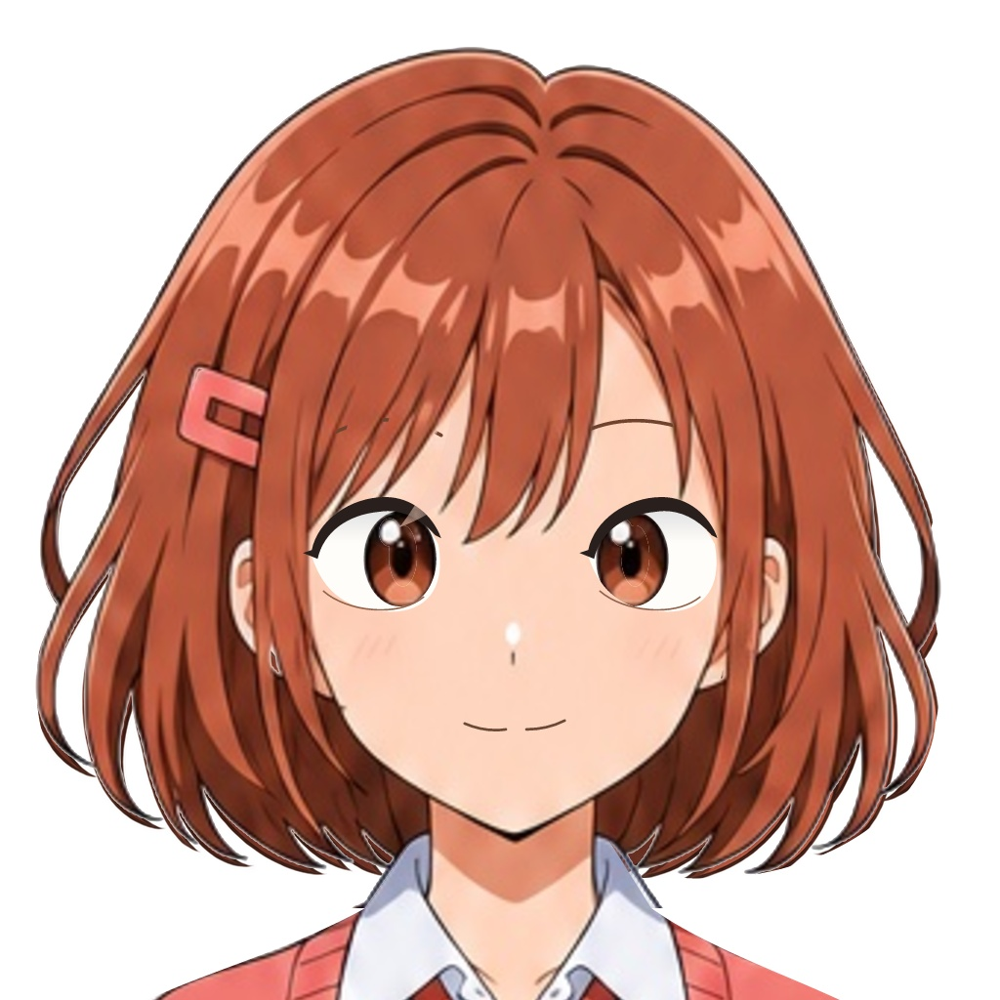

# こよみ Live2Dモデル

『ためし部』の小坂こよみのLive2D制作データです。通常・笑顔・驚きの表情を追加した **v21** を収録しています。v20の顔立ち、顔向き・まばたき・口の開閉・髪揺れを保持しています。

[音声付き確認動画（9.5秒）](preview/self-introduction.mp4) · [動きの比較画像](preview/motion-contact-sheet.jpg)

## フォルダー構成

| フォルダー | 内容 |
| --- | --- |
| `runtime/` | MOC3、モデル設定、テクスチャ、モーション。フォルダー一式で利用 |
| `source/` | Cubism編集用CMO3、レイヤーPSD、分割PNG・境界SVG、レイヤー一覧 |
| `audio/` | セリフ、VOICEVOX調声設定。WAVのローカル生成・追加手順 |
| `preview/` | 正面画像、実機録画から作った確認動画、比較画像 |
| `docs/` | 制作・再生・利用条件の説明 |
| `verification/` | 実機確認結果、各ファイルの容量・SHA-256 |

[モデル・編集素材・確認動画のZIP](https://github.com/tyamada/manga-prompt-kit/releases/tag/koyomi-live2d-v21-20261123)

## 再生・編集

1. Live2D Cubism Viewerで [`runtime/koyomi.model3.json`](runtime/koyomi.model3.json) を開きます。
2. `motions > Greeting > self-introduction` を選択して再生します。配布モデルは無音で動きます。音声の追加は[audio/README.md](audio/README.md)を参照してください。
3. Viewerは対象モデル1つだけを開いて再生します。旧版の確認ウィンドウが複数開いていると、描画負荷によって口の表示が遅れる場合があります。
4. 保存モーションだけを確認する場合は、Viewerの自動目パチ・カーソル追従・呼吸・物理演算をオフにします。`HairTest > hair-test` は髪だけの動きを確認できます（再生前にパラメータをデフォルトに戻してください）。
5. `expressions` から通常・笑顔・驚きを選べます。自己紹介は表情切り替えを含むため、その確認時は手動表情を解除してください。`ExpressionTest > expression-test` は同じ口開きで3表情を比較します。
6. 編集にはCubism Editorで [`source/koyomi-v21.cmo3`](source/koyomi-v21.cmo3) を開きます。原画の変更にはPSD・分割素材を使います。

書き出し・確認環境はCubism 5.3.04 FREE、SDK 5.3対応です。Editorから再書き出しした場合は、モーション・音声の参照設定も保持または再設定してください。

顔の小さな左右・上下向きと傾き、まばたき、口の開閉に対応しています。肩は顔の変形から分離しています。前髪と横髪は一枚の素材を連動させた小さな揺れです。大きな横顔・毛束の独立した風揺れは含みません。髪揺れはモーション収録で、リアルタイムのphysics3設定ではありません。

[髪だけの確認動画](preview/hair-test.mp4) · [髪の比較画像](preview/hair-comparison.jpg)

音声：**VOICEVOX:春日部つむぎ**。音声・音声を含む動画の利用は[クレジットと利用条件](docs/credits.md)を確認してください。

詳細：[制作と確認記録](docs/production.md)。独自のモデル・素材・文章・映像は[CC BY 4.0](LICENSE.md)で提供します。合成音声は対象外です。[無音版動画](preview/self-introduction-silent.mp4)はCC BY 4.0で利用できます。

[表情の比較画像](preview/expression-comparison.jpg) · [表情比較動画](preview/expression-test.mp4)

大きな横顔・毛束ごとの独立した動きは次版で制作中であり、このv21の対応範囲には含めていません。

## 初期計画の残作業

現在のv21は顔・肩までの安定版です。[全体計画と完了条件](docs/roadmap.md)に未完成項目を記録しています。[開発中の資料と6表情・30秒シーンの試作](development/README.md)も保存しています。全身・手の演技・大きな横顔・独立毛束は完成版には含まれません。
