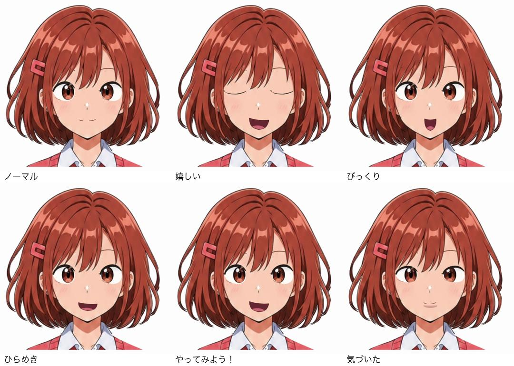

# v23：6表情・30秒シーンの試作

**初期計画の6表情を既存の口・眉・目開閉で試した開発版です。採用表情集の再現完成版ではありません。v22の大きな横顔・個別毛束は統合していません。**

[30秒の音声付き実機録画](preview/showcase-30s.mp4) · [無音版](preview/showcase-30s-silent.mp4)

## 試し方

Cubism Viewerで `runtime/koyomi.model3.json` を開き、`motions > Showcase > showcase-30s` を再生します。配布設定にはSound参照がなく無音です。音声は[生成・追加手順](../../audio/README.md)に従い利用者自身で追加できます。確認動画にはVOICEVOX:春日部つむぎの音声を含みます。

- 0〜約9秒：v21の自己紹介曲線を保持した音声同期・顔の小さな向き・まばたき・髪揺れ。
- 10〜28秒：ノーマル、嬉しい、びっくり、ひらめき、やってみよう！、気づいたを順に比較。
- 手動プリセットはexpressionsの6個から選べます。目の開閉はMultiply、口形と共通眉はOverwriteで、口開閉は上書きしません。嬉しいは閉じ目を持続させるため、通常へ戻すと目が開きます。

比較シーンでは演技ごとに口の開きを変えています。音声部分の9曲線はv21と同一です。6表情部分の開閉は表情比較用で、音声駆動ではありません。手動表情と保存シーンの表情曲線は重ねずに確認してください。

MOC3はv21と同一です。編集時は[既存のv21 CMO3](../../source/koyomi-v21.cmo3)を基準にし、ここにあるexp3とmotion3を再設定します。新しいネイティブ変形を追加した版ではありません。

## 残る品質改善

嬉しいの閉じ目は通常のまばたき形状の流用で、採用画像の弧を描く笑顔目は未実装です。ひらめきの輝く目、やってみようの姿勢、気づいたの視線と専用口形も未実装。口と眉だけでは似て見える表情が残ります。左右眉は共通制御です。これらを完成済みとは扱いません。

録画は映像と実際のシステム音声を同時収録し、共通の開始点で30秒を切り出しました。音声と映像を別々にずらす補正はしていません。冒頭の口の遅れは推定約18ms（測定精度約33ms）、肩4領域は冒頭280フレームで移動0pxでした。計測値と限界は `verification.json`。大きな横顔・独立毛束・体・リボン・手・全身およびVTube Studioは未完了です。

独自の素材・設定・映像部分は[CC BY 4.0](../../LICENSE.md)。**音声付き動画の合成音声は対象外**で、VOICEVOXと春日部つむぎの規約が適用されます。単体WAVと全画面録画は公開していません。
