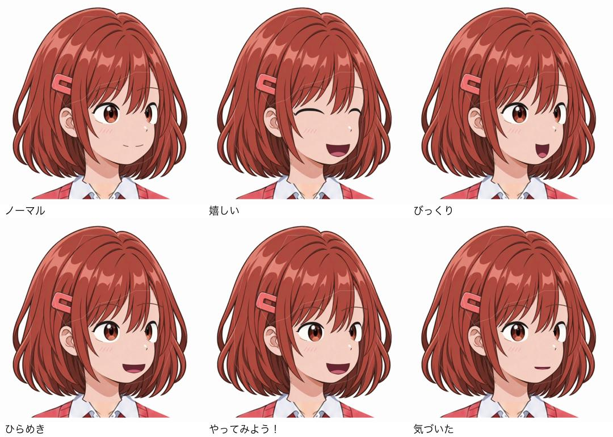

# v32 右45度の横顔組込み試作

**開発版です。安定配布のv31を置き換えるものではありません。** 右45度は作画上の目安で、パラメータ値から実角度を測定したものではありません。

[右45度・音声付き30秒](preview/showcase-r45-30s.mp4) · [右45度・無音](preview/showcase-r45-30s-silent.mp4) · [通常向き・音声付き30秒](preview/showcase-30s.mp4) · [通常向き・無音](preview/showcase-30s-silent.mp4)

音声：**VOICEVOX:春日部つむぎ**。Cubism Viewerでの再生を収録しました。動画の音声と映像を別々にずらす補正や、録音後の音声差し替えはしていません。先頭の待ち時間は音声・映像を一緒にカットしています。

## 追加したもの

右45度の原画を丸い頬と小さい顎へ調整し、輪郭から離れた小さな画素を除去しました。目・眉・口を消した下地を補完し、表示切替用の後ろ髪・顔・前髪3パーツを追加しています。これは最終的な毛束・皮膚の完全独立分割ではありません。元の35層を保持した38層PSDと、3層だけの追加用PSDを保存しました。

v31の目・眉・口・閉眼線・笑顔目・視線・6表情を横顔へ配置する親変形を追加しています。元の顔・鼻・髪と7毛束は横顔時に直接非表示にし、二重表示を防ぎました。肩は顔とは別です。右45度の髪は現段階では頭部に追従するだけで、専用の毛束物理演算は未設定です。

## 開く・再生する

1. Cubism Viewerで [`runtime/koyomi-v32.model3.json`](runtime/koyomi-v32.model3.json) を開きます（SDK 5.3対応）。
2. 自動目パチ・カーソル追従・呼吸・アイドリングモーション・手動表情は解除し、物理演算をオンにします。最初はパラメータをデフォルトに戻してください。
3. `motions > ShowcaseR45` が右45度、`Showcase` が通常向きです。右45度から通常へ戻るときも、いったんパラメータをデフォルトに戻します。
4. 配布モデルは無音です。音声付きの確認は上記動画を使います。音声を追加する場合は、安定版の音声追加手順を参照してください。WAVの相対参照は配布設定から除いています。
5. 編集用は [`source/koyomi-v32.cmo3`](source/koyomi-v32.cmo3)。統合原画は [`source/koyomi-v32.psd`](source/koyomi-v32.psd)、追加分だけのPSDは [`source/profile-r45-add.psd`](source/profile-r45-add.psd) です。統合38層PSDを、旧26層のPSDに差し替えないでください。

`ParamProfileR45` は0が通常、1が右45度です。**途中の値は頭部が重なって見えるため、滑らかな顔向きの完成形として使えません。** 右45度用モーションでは1に固定しています。左向き・80度・途中角度の原画とリグは未完成です。

## 保持と検証の範囲

元の音声、30秒モーション、6表情の設定ファイル、物理演算設定、35層PSDの元レイヤーは保持しています。既存テクスチャのUVと元から表示されていた画素は同一です。追加3パーツだけを空き領域へ50%で配置しました。

正面の形状差は浮動小数点計算の範囲（原画1024px換算で最大約0.0003px）です。ただし親変形の追加により、通常向きの30秒シーンでも顔パーツの位置に最大約2.18原画pxの差があります。広い顔向きの360条件では最大約4.74pxです。v31との厳密な形状一致が必要な場合は、安定版v31を使用してください。

通常360条件と横顔・途中値720条件で、表示中のパーツに新たな三角形の反転はなく、口開閉0.1以上では閉眼中も閉じ口線は非表示でした。非表示の閉眼パーツには縮退三角形の符号変化がありますが、表示中の反転とは区別して記録しています。

動画から測った口の遅れは、通常約16ms、右45度約38ms（30fpsの測定誤差約33ms）。肩4領域の移動は両動画で0pxでした。これは口面積と曲線の対応による推定で、音素単位の一致を保証するものではありません。[実行確認記録](verification/runtime.json)と[形状差の記録](verification/motion-preservation.json)を参照してください。

## 利用条件

独自のモデル・原画・文書・動画の映像部分はCC BY 4.0です。AI生成・補完部分を含み、権利の存在と保有の範囲で提供します。合成音声は対象外で、VOICEVOX・春日部つむぎの規約に従います。音声付き2動画を映像も音声も一律にCC BY 4.0として再配布しないでください。無音版も同梱しています。単体WAV、個人パスが映る全画面録画、SDK・アプリ本体は含みません。

元のv31モデルとReleasesの安定版ZIPは保持しています。次の工程は左向き・80度の原画整備、隠れ部分と毛束の最終分割、途中角度の連続変形です。
