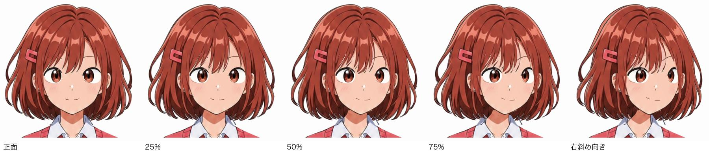
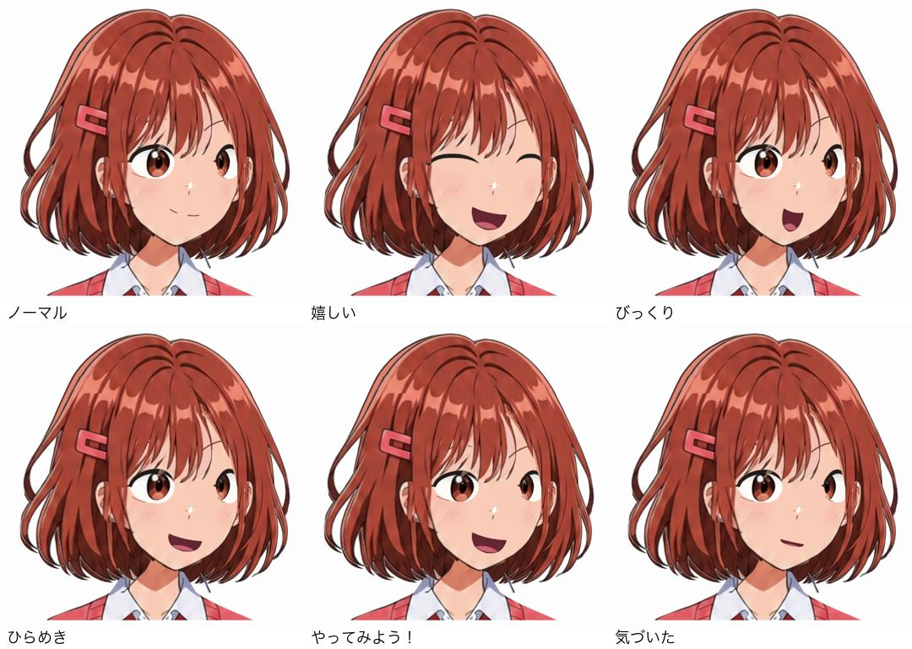

# こよみ v33：正面から右斜めへの連続向き

v31の顔立ちを保ちながら、v32で二重輪郭が出ていた途中の切替を作り直した検証版です。**同じ原画を連続して変形し、頭部画像の半透明切替を使いません。** 右45度は作画上の目標で、実際の角度を測定したものではありません。

[音声付き・連続右向き30秒](preview/showcase-turn-30s.mp4) · [同じ動画の無音版](preview/showcase-turn-30s-silent.mp4) · [途中の口・閉眼を低速確認](preview/smooth-turn-check.mp4)

[音声付き・右向き終点の6表情30秒](preview/showcase-r45-30s.mp4) · [終点の無音版](preview/showcase-r45-30s-silent.mp4)

音声：**VOICEVOX:春日部つむぎ**。Cubism Viewerの実際の再生を収録しています。動画の音声・映像を別々にずらす補正や、録音後の音声差し替えはしていません。先頭の待ち時間は音声と映像を一緒にカットしています。

## v31の顔立ちと元データ

連続向きの値が0のとき、顔向き・上下・口・閉眼の360条件と、元の30秒モーションの901フレームで、v31との形状差は**0px**、表示率の差も0でした。v32にあった通常シーンで最大約2.18原画pxの形状差を解消しています。

35層PSDのうち33層は描画内容・位置・可視状態が元と同じです。首と肌の2層には、正面で隠れる下描きだけを補完しました。**35層を合成した正面画像はv31と画素単位で同一**です。表情・音声・元の30秒モーション・物理演算設定を保持し、目・眉・口・髪留めの見える原画を描き替えていません。

## 開く・再生する

1. Cubism Viewerで [`runtime/koyomi-v33.model3.json`](runtime/koyomi-v33.model3.json) を開きます（SDK 5.3対応）。
2. 自動目パチ・カーソル追従・呼吸・アイドリングモーション・手動表情は解除し、最初にパラメータをデフォルト値へ戻します。
3. `motions > ShowcaseTurn` は正面と右斜めを滑らかに往復する30秒シーンです。口・まばたき・6表情・小さな顔の傾きと、元の髪物理演算を併用するため、**物理演算をオン**にします。
4. `ShowcaseR45` は右向きの終点で同じ音声と6表情を確認します。`Showcase` は通常向きです。各シーンには連続向きの値も含めています。
5. `SmoothTurnCheck` は0・25・50・75・100%の向きで口・閉眼を確認する20秒モーションです。比較用には物理演算をオフにします。上記の低速動画もオフで収録しています。
6. 配布モデルは無音です。音声付き確認は動画を利用してください。自分の環境で音声を用意する場合は[安定版の音声追加手順](https://github.com/tyamada/manga-prompt-kit/blob/main/live2d/koyomi/audio/README.md)を参照します。単体WAVとSound参照は配布物から除いています。

連続向きは `ParamProfileR45`（0〜1、初期値0）です。途中の値も使用できます。元の `ParamAngleX/Y/Z` による小さな揺れ、まばたき、視線、口、6表情、毛束の制御と併用します。表情設定は口開閉を上書きしません。

## 編集データ

[`source/koyomi-v33.cmo3`](source/koyomi-v33.cmo3) がCubism編集原本、[`source/koyomi-v33.psd`](source/koyomi-v33.psd) が35層の統合原画です。首・肌の補完は同フォルダーのSVG/PNG、構成は [rig-notes.json](source/rig-notes.json) に記録しました。

`neck-update-original-layers.psd` は首・肌の補完を含む**元の26層PSDへの差し替え専用**です。35層の統合PSDを元の26層PSDへ差し替えると、別PSDで追加した毛束や笑顔目を重複させる可能性があるため、用途を区別してください。

## 実行確認と残る範囲

途中値を含む1,800条件で表示中パーツの新たな三角形反転は0。0〜1を1,000段階に分けた検査でも形状は連続し、表示率は変わりません。口開閉0.1以上では閉眼中も閉じ口線は非表示です。6表情と口の24条件、髪揺れ56条件も確認しています。

音声付き2動画では口の遅れをいずれも約16msと推定しました（30fps測定の誤差約33ms）。肩4領域の移動は0pxでした。口面積と曲線の対応による推定で、音素単位の一致を保証するものではありません。[実行記録](verification/runtime.json)と[元のモーションの比較](verification/motion-preservation.json)を参照してください。

この版は正面原画を使った右斜め向きの連続変形です。専用の鼻・耳・遠い目の隠れ方まで完成させた横顔輪郭、左向き・80度、VTube Studio追従、全身・手の演技は別の残作業です。v32の専用原画・固定角度試作と、安定配布v31は保全しています。

## 利用条件

独自のモデル・原画・文書・動画の映像部分は **CC BY 4.0**、合成音声は対象外です。[LICENSE.md](LICENSE.md)と[CREDITS.md](CREDITS.md)を確認してください。音声付き2動画を映像も音声も一律にCC BY 4.0として扱わないでください。無音版も同梱しています。単体WAV、個人パスが映る全画面録画、SDK・アプリ本体は含みません。

## 編集原本の保存差の修正（2026-11-24）

公開当初のCMO3が最終の実行モデルより前の保存状態だったため、最終編集状態へ更新しました。開き直して書き出したMOC3・テクスチャが、確認済みv33とバイト単位で一致しています。実行モデルと確認動画は変更していません。[照合記録](verification/editor-recovery.json)。
