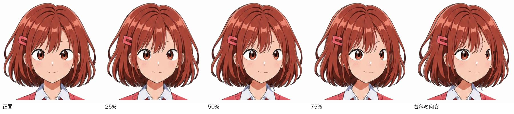
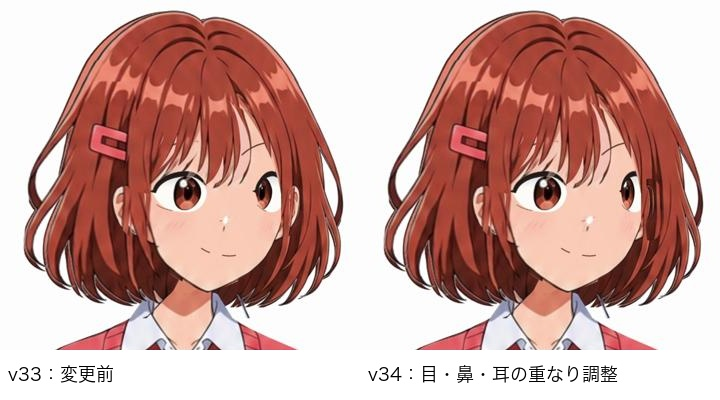
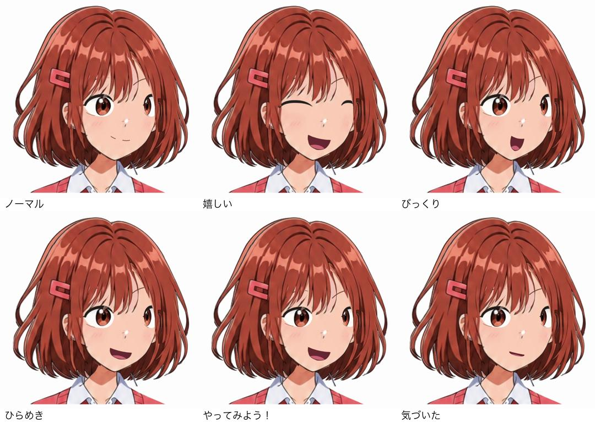

# こよみ v34：右斜め向きの遠近調整

v33の同じ原画と連続変形を基に、遠い目の幅、鼻の位置・幅、鼻筋側の目の隠れ方と耳が髪から出る範囲を調整した開発版です。頭部画像の切替は使いません。45度は作画上の目標で、実角度を測定したものではありません。

[音声付き・連続向き30秒](preview/showcase-turn-30s.mp4) · [無音版](preview/showcase-turn-30s-silent.mp4) · [途中角度の低速確認](preview/smooth-turn-check.mp4)

[音声付き・右向き終点30秒](preview/showcase-r45-30s.mp4) · [無音版](preview/showcase-r45-30s-silent.mp4)

音声：**VOICEVOX:春日部つむぎ**。Viewerの実再生を録画し、音声と映像を別々にずらす補正・録音後の音声差し替えは行っていません。待ち時間は音声と映像を一緒にカットしています。今回の口面積と元モーションの比較では、音声に対する口の遅れは連続向き約0.008秒、右向き終点約0.006秒（30fpsの測定分解能は約0.033秒）でした。録画中はViewerを1画面だけ動かし、動画変換などの重い処理を停止しています。

## 調整内容

- 通常目・閉じ目・笑顔目を同じ枠で遠近変形し、遠い側を控えめに狭めました。虹彩は元の視線移動の親設定を保った別枠で合わせています。
- 鼻は元の小さな描き方を残し、右向きでの位置と幅を調整。耳は元の横髪へ追従する覆いで隠します。元の35層を保持し、元の肌・髪の画素から鼻筋側と遠い耳を覆う小さな2層を追加。正面では非表示、右向きで表示します。肌の試行変形は解除しました。
- 低速確認で見つかった、ごく小さな開口で閉じ口線と口内の線が重なる問題を修正。開口0〜0.049では口内・舌を非表示、0.05以上では閉じ口線を非表示にし、切替区間を0.001へ短縮しています。歯は既存の表示率とクリッピングを保持します。
- 元のWAV、30秒モーション、6表情、物理演算設定を保持。配布物には単体WAVを含めません。

## 開く・再生する

1. Cubism Viewerで [`runtime/koyomi-v34.model3.json`](runtime/koyomi-v34.model3.json) を開きます（SDK5.3対応）。
2. 自動目パチ・カーソル追従・呼吸・アイドリングモーション・手動表情を解除し、パラメータをデフォルトへ戻します。
3. `ShowcaseTurn` は連続向き、`ShowcaseR45` は終点、`Showcase` は通常向きの30秒シーンです。元の毛束物理演算も使うため、物理演算をオンにします。
4. `SmoothTurnCheck` は途中の5段階で口・閉眼を確認する20秒シーンです。この比較動画は物理演算オフです。
5. 配布モデルは無音です。音声付き確認は動画を利用してください。音声を自分で追加する場合は[安定版の案内](https://github.com/tyamada/manga-prompt-kit/blob/main/live2d/koyomi/audio/README.md)を参照してください。

連続向きは `ParamProfileR45`（0〜1、初期値0）。元の顔向き・傾き・視線・まばたき・口・6表情と併用します。

## 編集原本と検証

[`source/koyomi-v34.cmo3`](source/koyomi-v34.cmo3) が編集原本、[`source/koyomi-v34.psd`](source/koyomi-v34.psd) が37層PSDです。元の35層は同一、追加2層は初期非表示で、正面の合成画素はv33と同一です。追加用の2層PSDは `depth-overlap-add.psd` です。`neck-update-original-layers.psd` は元の26層PSDへ差し替える専用素材で、37層PSDとは用途を区別してください。[設定記録](source/rig-notes.json)。

正面の通常顔の形状差はv33に対して約0.00017原画px。追加した目の親変形の補間により、元の30秒901フレームでは最大約2.17原画px、顔X±30等の360条件では最大約4.66原画pxの差があります。完全な形状一致とは扱いません。通常シーンの肌・輪郭・髪の形状差は0です。開き始めの口の表示率は上記の不具合修正のため変更しています。

追加した覆いは135条件で形状反転0。肌の再配置ではUVが最大約0.45テクスチャpx調整され、肌のアトラスを再描画しています。他の既存素材の画素は保持しています。保存済みCMO3を開き直し、同一のMOC3・テクスチャを再現できることも確認しました。

途中値を含む1,800条件で新たな三角形反転0、1,000段階の連続性、6表情と口の24条件、髪揺れ56条件を確認。口の切替は2,000条件で確認しました。[検証記録](verification/runtime.json)。

## 範囲と利用条件

この版は正面原画を使った右斜めの遠近調整です。鼻の描線は元のこよみの小さな表現を保ち、鼻筋側の覆いで遠い目の鼻側を隠します。左向き・80度、VTube Studio追従、全身・手の演技も別の残作業です。v31安定版、v32試作、v33は保持します。

独自のモデル・原画・文書・映像部分は **CC BY 4.0**、合成音声は例外です。[利用条件](LICENSE.md)・[クレジット](CREDITS.md)を確認してください。単体WAV、個人パスが映る全画面録画、SDK・アプリ本体は含みません。
