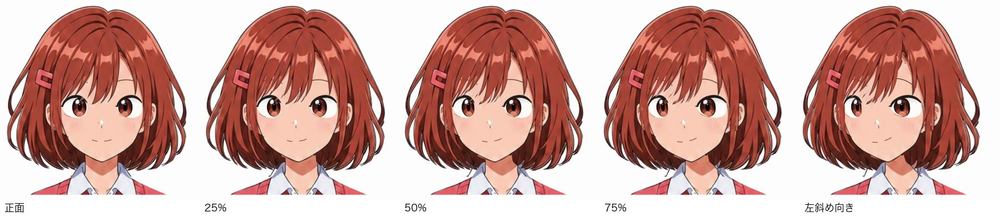
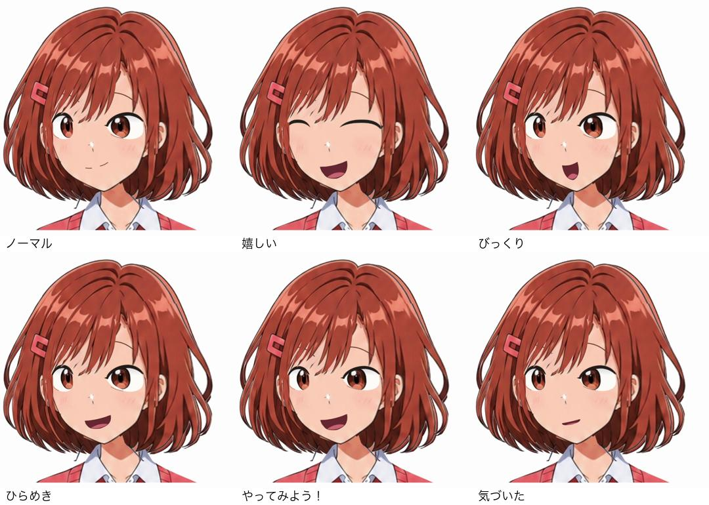

# こよみ v35：左右の顔向きの土台

v34を基に左斜め向きの頭部・髪の追従を追加した開発版です。正面・右向きは保持し、音声同期・まばたき・口・6表情と一緒にViewerで確認しました。左側専用の鼻筋・遠い目・耳の細かな隠れ方は、右側v34より未完成です。左右80度までの完成横顔とは区別してください。

[左右を行き来する音声付き30秒](preview/showcase-both-30s.mp4) · [無音版](preview/showcase-both-30s-silent.mp4) · [左向きの低速確認](preview/smooth-left-check.mp4)

[左斜め終点・音声付き30秒](preview/showcase-l45-30s.mp4) · [無音版](preview/showcase-l45-30s-silent.mp4)

音声：**VOICEVOX:春日部つむぎ**。Viewerの実再生を録画しています。動画と音声を別々にずらす補正、収録後の音声差し替えは行っていません。待ち時間は映像と音声を一緒にカットしています。録画中は重い動画変換を止め、確認用Viewerを1画面だけ動かしました。測定結果は[連続向き](verification/both-video-verification.json)・[左終点](verification/l45-video-verification.json)に記録しています。今回の測定では、音声に対する口の遅れは左右の連続向き約0.020秒、左終点約0.012秒でした。30fpsの測定分解能は約0.033秒です。

## 変更内容と再生

- 頭部の左右向きと髪全体の親変形に左側キーを追加しました。髪留めを含む原画全体を反転する方式ではなく、元の37層PSDと6毛束の子設定を保持しています。
- 既存ID `ParamProfileR45` は互換性のため保持し、範囲を **-1〜1** に拡張。0は正面、正は従来の右向き、負は今回の左向きです。角度は作画上の目標で、物理的な45度を測定したものではありません。
- 右向き専用の目・鼻・耳の局所調整は左側で正面基準へ戻します。右用の覆いを左側に誤表示しません。左専用の細部の作り込みは次の工程です。
- v34の口の表示切替（閉口0.049まで、0.05以上で閉じ口線を非表示）、元WAV、元の発話曲線、6表情、物理設定を保持しました。

1. Cubism Viewer（SDK5.3対応）で [`runtime/koyomi-v35.model3.json`](runtime/koyomi-v35.model3.json) を開きます。
2. 自動目パチ・カーソル追従・呼吸・アイドリング・手動表情をオフにして、パラメータを初期値へ戻します。
3. `ShowcaseBoth` が左右の連続向き、`ShowcaseL45` が左終点です。髪の物理演算をオンにして再生します。`ShowcaseTurn`・`ShowcaseR45` は従来の右向きシーンです。
4. `SmoothLeftCheck` は物理演算オフで、5段階の向きで口と閉眼を確認します。
5. 配布モデルは無音です。音声付き確認は動画を使用してください。単体WAVは含みません。

## 編集原本と確認範囲

[CMO3編集原本](source/koyomi-v35.cmo3)と[37層PSD](source/koyomi-v35.psd)を同梱。PSD・テクスチャ・6表情・物理演算設定はv34と同一です。[保持の照合](source/v35-preservation.json)・[制作設定](source/rig-notes-v35.json)。

正面・右向き2,160条件ではv34との形状差が最大約0.019原画px、表示率差0です。完全な形状一致とは扱いません。左向き2,160条件で表示中の三角形の反転0。非表示状態の三角形には符号変化12件があり、表示中の形状とは区別して記録しています。[実行モデル検査](verification/core.json)。視線・表情・髪・口線の追加検査と、保存したCMO3からの再出力照合も同梱しています。

この版は左斜めの土台です。左側専用の鼻筋・遠い目・耳の隠れ方、左右80度の専用横顔、全身・手、VTube Studio追従は残作業です。安定版とReleasesはv31を維持します。

## 利用条件

独自のモデル・原画・文書・映像部分は **CC BY 4.0**、合成音声は例外です。[利用条件](LICENSE.md)・[クレジット](CREDITS.md)。単体WAV、個人パスが映る全画面録画、SDK・アプリ本体は公開対象から除外しています。

制作時に参照した機能：[Live2D公式・動きの反転](https://docs.live2d.com/cubism-editor-manual/motion-mirroring/)。反転後に親子の追従と実行モデルの表示を確認しています。
