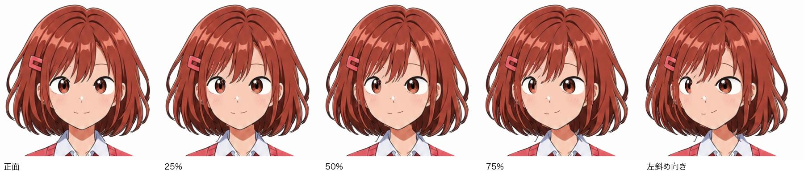
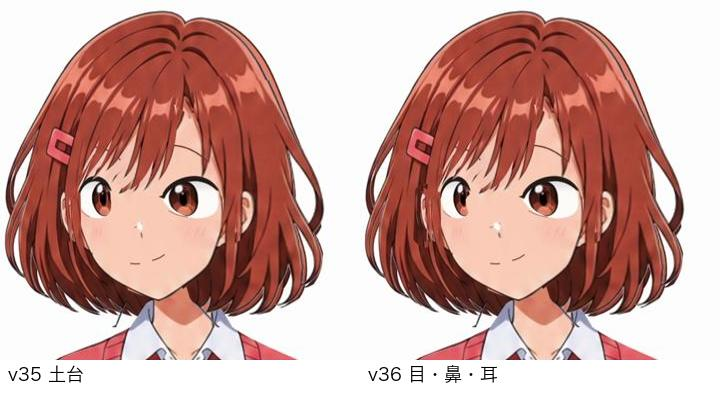
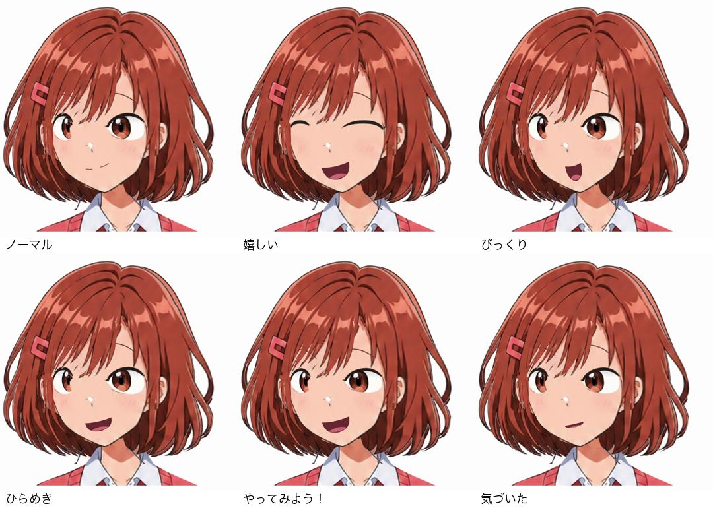
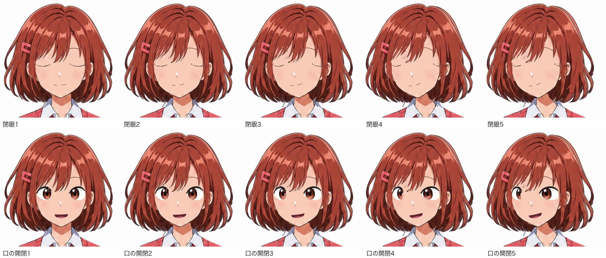

# こよみ v36：左斜めの目・鼻・耳の調整

v35の左右向きを基に、左向きで遠くなる目の幅、鼻筋側の隠れ方、耳を覆う髪を追加調整した開発版です。元の顔立ち・音声の発話曲線・6表情・毛束物理演算を保ちながら、Viewerで実再生を確認しました。

[左右連続・音声付き30秒](preview/showcase-both-30s.mp4) · [無音版](preview/showcase-both-30s-silent.mp4) · [途中角度の低速確認](preview/smooth-left-check.mp4)

[左終点・音声付き30秒](preview/showcase-l45-30s.mp4) · [無音版](preview/showcase-l45-30s-silent.mp4)

音声：**VOICEVOX:春日部つむぎ**。Viewerでの実再生を録画し、動画と音声を別々にずらす補正・収録後の音声差し替えは使っていません。待ち時間は映像と音声を一緒にカットしています。口の遅れは測定上、左右連続約0.008秒、左終点約0.014秒（30fpsの測定分解能は約0.033秒）。[連続向き](verification/both-video-verification.json)・[左終点](verification/l45-video-verification.json)。録画中はViewerを1画面だけ動かし、重い動画変換を止めています。

## 調整内容

- 左向きで遠くなる通常目・笑顔目・閉じ目・まぶたを専用の枠にまとめ、控えめに細めました。瞳・虹彩・ハイライトは元の視線移動の親設定を保つ別枠で合わせています。
- 元の小さな鼻の描き方を保ち、左向きでの位置・幅を調整。鼻筋側は元の肌の画素を切り出した小さな覆いを追加しました。左右の原画が非対称なので、右用素材の単純な画像反転は使っていません。
- 遠い耳は元の横髪の画素を使った覆いで隠し、対応する毛束の揺れへ追従します。新しい2層は左終点で表示、正面・右向きでは非表示です。
- 閉じ目の画像に広い透明余白があったため、左の遠い目になる閉じ目 `50_Eye_R_Closed / ArtMesh0` のメッシュを4頂点から31頂点へ変更。線が欠けた粗い試行を修正し、分割間隔20・境界余白30で線を覆いました。元の画像と開閉の表示率は保持しています。
- 元のWAV、既存モーション、6表情、物理設定を保持し、口の表示切替（0.049まで閉じ口、0.05以上で閉じ口線を非表示）も継続しています。単体WAVは配布しません。

## 開く・再生する

1. Cubism Viewer（SDK5.3対応）で [`runtime/koyomi-v36.model3.json`](runtime/koyomi-v36.model3.json) を開きます。
2. 自動目パチ・カーソル追従・呼吸・アイドリング・手動表情をオフにし、パラメータを初期値に戻します。
3. `ShowcaseBoth` が左右連続、`ShowcaseL45` が左終点です。髪の物理演算はオンで再生します。
4. `SmoothLeftCheck` は物理演算オフで、途中5段階の口とまばたきを確認します。`ShowcaseTurn`・`ShowcaseR45` は従来の右向きシーンです。
5. 配布モデルは無音です。音声付き確認は動画を使用してください。

既存ID `ParamProfileR45` は-1〜1。0は正面、正は右、負は左です。45度は作画上の目標で、物理的な角度を測定したものではありません。

## 編集原本と検証

[CMO3](source/koyomi-v36.cmo3)と[39層PSD](source/koyomi-v36.psd)を同梱。元の37層は画素・位置・表示状態を保持し、新しい2層は初期非表示です。正面のPSD合成画素はv35と同一。[原画の照合](source/left-overlap-source.json)・[設定記録](source/rig-notes-v36.json)。追加用2層PSDは `left-overlap-add.psd` です。

正面・右向き2,160条件では、頂点数の変わらないパーツの最大形状差は約4.052原画px、表示率差0。元の30秒901フレームでは最大約0.353原画px、通常の正面は約0.046原画pxです。完全な形状一致とは扱いません。閉じ目は頂点数が変わるため点ごとの比較から除外し、画像の被覆と録画で確認しています。[形状照合](verification/motion-preservation.json)。

左向き2,160条件と、表情・視線・髪1,620条件で表示中の三角形反転0。非表示状態の三角形の符号変化は96件で、表示中の形状と区別して記録。口切替は2,000条件で確認しました。[実行モデル](verification/core.json)・[組合せ検査](verification/invariants.json)。

追加素材は100%で空き領域へ配置。既存の見える画素と透明度は保持し、透明部分のRGBの変化は別記録しています。[アトラス照合](verification/atlas-preservation.json)。閉じ目の被覆では画素境界の丸めによる6画素が1テクスチャpx以内にあり、それを超える欠けは0。[閉じ目の検査](verification/closed-mesh-coverage.json)。保存した編集原本を開き直し、同一のMOC3・テクスチャ・物理JSONを再出力できることも確認しています。[再出力照合](verification/editor-roundtrip.json)。

左右80度の専用横顔、全身・手の演技、VTube Studio追従は残作業です。安定版とReleasesはv31を維持し、この版は開発版として追加しています。

## 利用条件

独自のモデル・原画・文書・映像部分は **CC BY 4.0**、合成音声は例外です。[利用条件](LICENSE.md)・[クレジット](CREDITS.md)。単体WAV、個人パスが映る全画面録画、SDK・アプリ本体は配布しません。

制作時の機能参照：[Live2D公式・ワープデフォーマ](https://docs.live2d.com/cubism-editor-manual/making-and-placement-of-warp-deformer/)。
