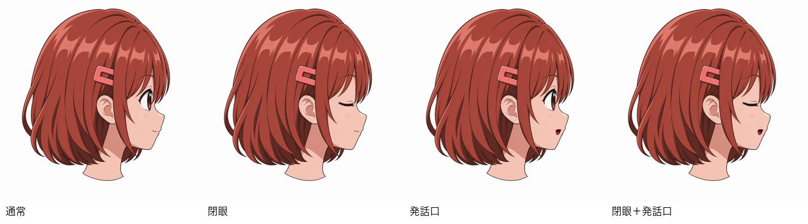

# v37：右80度の専用原画と開閉試作

**制作途中の独立試作です。v36への接続や、自然なまばたき・音声同期・6表情が完成した80度モデルではありません。** v36の編集原本・実行モデル・発話データは変更していません。

[Viewer確認動画（無音）](right80-states-check.mp4)・[原画の4状態](right80-states.jpg)

元の正面デザインを参照し、画面右へ大きく向いた頭部、顔の下塗り、閉眼・発話口を作成。後髪／顔・耳・首／前髪・髪留め／眉／開眼／閉じ口／閉眼／開き口の8層へ分けました。角度は作画上の目安で計測値ではありません。

- [Cubism編集原本](source/koyomi-v37-right80-study.cmo3)
- [8層PSD](source/koyomi-v37-right80-study.psd)
- [実行用試作](runtime/koyomi-v37-right80-study.model3.json)
- [素材の検査](source-verification.json)・[実行モデルの検査](runtime-verification.json)

Cubism Editorで取り込み、2048×2048の1枚へ100%で配置してMOC3を書き出しました。Viewerの`StateCheck`は通常→閉眼→発話口→閉眼＋発話口を各3秒表示します。これは0/1の終点だけを切り替える検査で、滑らかなまばたきの実演とは扱いません。

## 確認範囲と残作業

目は`ParamEyeROpen`、口は`ParamMouthOpenY`へ設定。終点では閉眼時に開眼画像が消え、最大開口時に閉じ口画像が消えることを実行データで確認しました。**中間値は表示率による重なりが残るため未合格**です。細い切替範囲への調整試行は最終データに採用していません。次は、まぶたの形状変形と唇の輪郭変形を作ります。

髪・顔の接合部は同じ原画の不透明な画素を3px重ねる構成に変更しました。毛束を動かすための隠れた領域の描き足しと、生成原画の透明輪郭の最終仕上げは残作業です。PSDの再合成には最大1階調の丸め差があります。

正面〜45度〜80度の途中形状、左80度、80度での視線・6表情・音声同期は未実装です。全身・手の演技・VTube Studio追従も残っています。既存の音声同期済みモデルはv36、安定版とReleasesはv31を維持します。

## 利用条件

独自画像・モデル・文書は、権利の存在と保有の範囲でCC BY 4.0です。[利用条件](LICENSE.md)・[生成方針とクレジット](generation-notes.md)。音声は同梱しません。既存のVOICEVOX:春日部つむぎ音声の例外は継続し、単体WAVや個人パスのある全画面録画は公開しません。SDK・アプリ本体は含みません。
