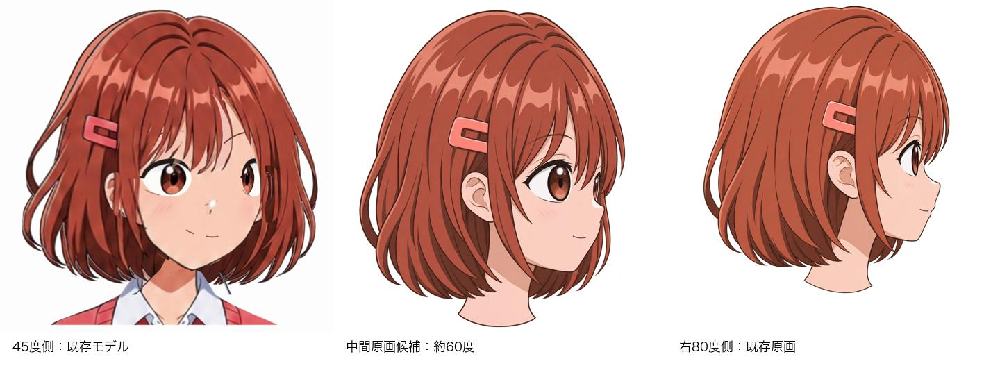

# v41：連続モーフ用の中間原画・準備版

**これは原画と仮分割PSDの準備版です。Cubismへの組み込み、まばたき・口のリグ、連続モーフの実行確認は未完了です。実行モデルの完成版ではありません。** [v40の確認モデル](../v40-right80-switching/README.md)と[通常配布v38](../../README.md)は変更していません。

45度側と右80度側の間をつなぐため、遠い目と頬が少し見える中間原画候補Cを作成しました。「約60度」は作画上の呼称で、物理角度の計測値ではありません。髪留め1個・栗色のボブ・茶色の瞳・丸い顔立ちを参照しています。頭の大きさ・首位置・細部の顔立ちはモデルへ合わせる調整が必要です。

## 保存したデータ

- [中間原画候補C](source/right60-candidate-C.png)
- [目・眉・口を外した下塗り](source/right60-underpaint.png)
- [仮分割PSD](source/right60-parts-draft.psd)：**8表示パーツ＋非表示の下塗り1層**。後ろ髪、顔・耳・首、前髪・髪留め、近い目、遠い目、近い眉、遠い眉、閉じ口を仮分割しています。
- [パーツと確認結果](source/parts.json)・[仮分割マスク](source/extraction-masks.json)・[目鼻口等の仮対応点](source/landmarks-draft.json)
- [生成条件とプロンプト](source/generation-prompts.json)

原画候補と下塗りは、既存画像を参照した画像生成で作成しました。分割では元の画素を抽出し、下塗りを別の非表示レイヤーに保管しています。通常の重ね合わせで原画を再構成したとき、PNGの差は0、PSDを開き直した差は色が最大1/255・透明度0でした。[検証記録](verification/source-check.json)。

## 未完了事項

仮分割の境界は未仕上げです。内部の透明度が主に253/255となっていること、透明境界に微小な独立画素7個があることも記録しています。近い目・遠い目はまだ全体を一つずつ切り出した段階で、白目・虹彩・まぶた・閉じ線の分離、口内・上下唇・舌の開閉用分離はこれからです。仮対応点は画像座標であり、Cubismの座標ではありません。

次に境界と透明度を仕上げ、45度・中間・80度の輪郭とパーツの隠れ方を合わせ、Cubismで連続変形を作成します。採用音声I・既存6表情・v39の開閉の保持は、組み込み後に改めて確認します。**この静止画比較を、連続モーフや音声同期の確認動画として扱わないでください。**

## 利用条件

独自原画・編集素材・文書・検証記録は、権利の存在と保有の範囲で **CC BY 4.0**。[利用条件](LICENSE.md)・[クレジット](CREDITS.md)。この準備版には音声、単体WAV、録画、アプリ・SDKを含みません。既存版の合成音声の例外は維持します。
