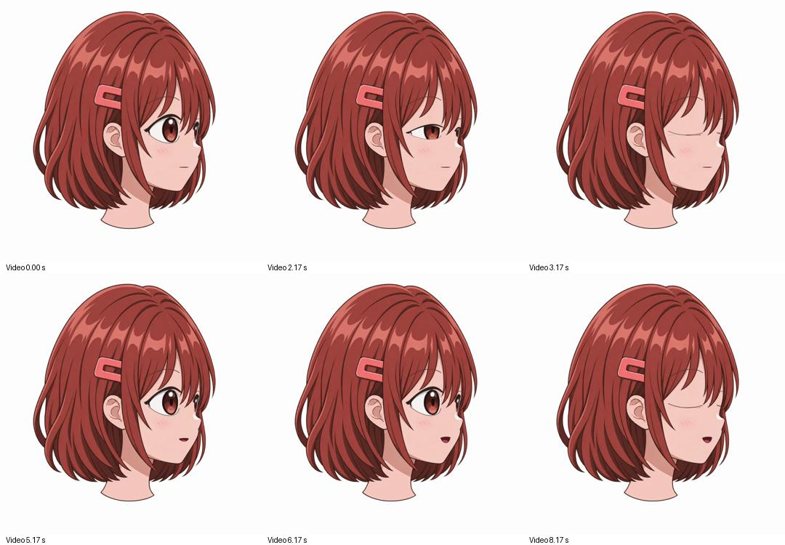

# v42：中間向きのまばたき・口開閉の実行試作

v41の中間原画候補Cを17パーツに分け、Cubismで目と口を動かせる単独モデルにしました。**向きは約60度の固定です。45度から80度への連続モーフ、および既存6表情・顔向き・髪揺れの統合は未完了です。** 約60度は作画上の呼称で、物理角度の計測値ではありません。通常配布[v38](../../README.md)と[v40](../v40-right80-switching/README.md)は保全しています。

## 確認動画

- [採用音声I・まばたき・口の同期確認（30秒）](preview/mid60-voice-30s.mp4)／[無音版](preview/mid60-voice-30s-silent.mp4)
- [目と口の低速開閉・途中形状（12秒・無音）](preview/mid60-states-12s.mp4)

音声：**VOICEVOX:春日部つむぎ**。既存v40の両目開閉と口開閉の動作曲線3本を、時刻・値・補間ごと変更せず使用しました。音声は採用音声Iです。動画は映像と音声を同じ時間だけ切り出し、音声単独の同期補正はしていません。収録音声と原音の相関は0.996、口内面積と動作曲線から求めた音声に対する口の差は約12msでした。30fpsと面積測定による限界があります。[同期測定](verification/video-sync.json)・[収録記録](verification/audio-capture.json)。

## モデルと編集素材

- 実行：`runtime/koyomi.model3.json`
- Cubism編集原本：`source/koyomi-v42-mid60.cmo3`
- 読み込み用PSD：`source/right60-rig-parts.psd`（17層）
- 各パーツのPNG・作画用SVG・[素材情報](source/parts.json)

Viewerで `Mid60States` を再生すると低速開閉、`Mid60Voice` を再生すると音声に合わせた開閉を確認できます。公開モデルは無音です。単体WAVとSound参照は含めません。手元で音声を組み合わせる場合は[採用音声Iの案内](../../audio/README.md)を参照してください。

原画内部の透明度と微小な独立画素は、元画像を保持した別コピーで調整しました。残した画素のRGBは変更していません。白目・虹彩の画像は固定し、変形する開口マスクで隠します。上下まぶたと閉じ線は別パーツです。両目の開度0で虹彩と開口の不透明度が0、専用閉じ線が1になること、途中形状で開口が単調に広がることを実行用Coreで確認しました。口内・舌・上下唇は一つのワープで開閉し、閉じ口が消えない厚さに調整しました。開閉中も頭部の頂点は変わりません。[検証記録](verification/core-verification.json)。

## 残る作業

この原画は候補であり、v38との顔立ち一致を完了した版ではありません。頭・髪・耳・首は一枚の固定下塗りです。角度ごとの輪郭・鼻・耳・遠い目の対応を整え、45→中間→80度を単一の形状としてつなぐ作業、6表情・毛束・体への統合と再検証が残っています。表情名だけを登録した完成版としては扱いません。30秒動画の後半も6表情の比較ではありません。

## 利用条件

独自モデル・編集素材・画像・モーション・文書・検証記録・映像部分は、権利の存在と保有の範囲で **CC BY 4.0**。**合成音声は対象外**で、VOICEVOXと春日部つむぎの規約に従います。[利用条件](LICENSE.md)・[クレジット](CREDITS.md)。単体WAV、全画面録画、アプリ・SDKは含みません。
