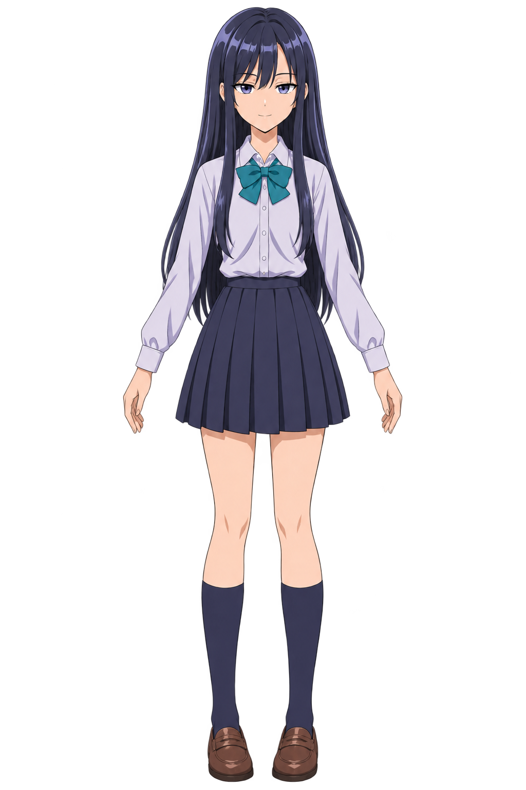

# 瀬尾凪｜Live2D口パク・まばたき試作

『ためし部』瀬尾凪の冬の室内制服モデルです。正面全身の原画、分割PSD、編集用CMO3、Cubism Viewerで再生できる口リグ試作を収録しています。

## 左右独立のまばたき＋口パク v4

[Viewer用モデル一式](development/front-separation/nagi-blink-lipsync-v4/runtime/) · [編集用CMO3](development/front-separation/nagi-blink-lipsync-v4/nagi-blink-lipsync-v4.cmo3)

左右の開閉値0.85で上まぶたの補助レイヤーが完全に透明になるよう調整し、全開に近いときに見えていた縁を抑えました。`nagi-blink-lipsync-v4.model3.json` の `Ritsu` で12.43秒の通しモーション、`IndependenceCheck` で片目ずつと両目の開閉を確認できます。

## 左右独立のまばたき＋口パク v3

[Viewer用モデル一式](development/front-separation/nagi-blink-lipsync-v3/runtime/) · [編集用CMO3](development/front-separation/nagi-blink-lipsync-v3/nagi-blink-lipsync-v3.cmo3)

左右の開閉値0.75にキーを追加し、全開に近いところで上まぶたの線を元のまつげに寄せました。`nagi-blink-lipsync-v3.model3.json` の `Ritsu` で12.43秒の通しモーション、`IndependenceCheck` で左右の開き始め・半閉じ・全閉を確認できます。口パクには元の口リグv3の曲線を使っています。

## 左右独立のまばたき＋口パク v2

[Viewer用モデル一式](development/front-separation/nagi-blink-lipsync-v2/runtime/) · [編集用CMO3](development/front-separation/nagi-blink-lipsync-v2/nagi-blink-lipsync-v2.cmo3)

左右のまぶたに半閉じの形を追加し、閉じ目の目尻が前髪に重なる範囲を調整しました。Cubism Viewerで `nagi-blink-lipsync-v2.model3.json` を開き、`Ritsu` で通しモーション、`IndependenceCheck` で半閉じと片目ずつ・両目の閉じを確認できます。音声を合わせる場合は下記の台詞と合成クエリを使います。

## 左右独立のまばたき＋口パク v1

[Viewer用モデル一式](development/front-separation/nagi-blink-lipsync-v1/runtime/) · [編集用CMO3](development/front-separation/nagi-blink-lipsync-v1/nagi-blink-lipsync-v1.cmo3) · [閉じ目のPSD](development/front-separation/nagi-blink-lipsync-v1/nagi-blink-lids.psd)

Cubism Viewer (for OW) 5.3.05で `nagi-blink-lipsync-v1.model3.json` を開き、`Ritsu` で口パクとまばたきの通しモーションを再生できます。`IndependenceCheck` では本人左目、右目、両目の順に閉じた状態を短く保持するので、発話中の重なりを確認できます。元の口パクv3の2曲線を使用しています。波音リツの音声を合わせる場合は下記の同じ台詞と合成クエリを使い、Viewerで生成したWAVを指定してください。

## 口リグ試作 v3

閉口線・開口輪郭・口内・舌を分け、`ParamMouthOpenY` で口の開閉、`ParamMouthForm` で横幅を制御します。v3では波音リツの合成フレームを元のWAVと照合して、開閉と母音の口幅が切り替わる時刻を調整しました。Cubism Viewer 5.3.05で約12.43秒の通し再生を確認しています。現段階で動作確認した範囲は正面モデルの口です。

| ファイル | 用途 |
|---|---|
| [Viewer用モデル一式](development/front-separation/mouth-rig-v5-ritsu-timing-v3/) | model3.json、MOC3、テクスチャ、v3モーション、発音境界の比較CSV |
| [編集用CMO3](development/front-separation/mouth-rig-v5-prototype/nagi-mouth-rig-v5-prototype.cmo3) | Cubism Editorで口の可動キーを編集 |
| [口リグ用分割PSD v5](development/front-separation/nagi-mouth-rig-source-v5.psd) | 口の4レイヤーと全身素材 |
| [口形の確認動画](development/front-separation/nagi-ritsu-lipsync-preview.mp4) | v3以前の画像合成プレビュー。音声は VOICEVOX:波音リツ |

1. Viewer用モデルのフォルダーを一式取得し、Cubism Viewer (for OW) 5.3.05以降で `nagi-mouth-rig-v5-ritsu-timing-v3.model3.json` を開きます。
2. モーション一覧の `Ritsu` から `nagi-namine-ritsu-vowels-v3` を選び、再生します。配布モデルは無音で再生できます。
3. 音声を合わせる場合は、[台詞](development/voice-audition/script.txt)と[合成クエリ](development/voice-audition/nagi-namine-ritsu-query.json)を使い、VOICEVOX:波音リツ（ノーマル、スタイル9）で合成します。試作時はVOICEVOX Core 0.17.0を使用しました。生成したWAVをViewerのモーション設定の「音声」で指定します。音声利用時は「VOICEVOX:波音リツ」を表示してください。[VOICEVOX 波音リツ](https://voicevox.hiroshiba.jp/product/namine_ritsu/) · [音源利用規約](https://www.canon-voice.com/terms/)

[Windows制作と検証の記録](docs/windows-production-start.md)

## 正面全身原画

2026年11月23日制作の原画 v1。

[透過PNGを開く](source/nagi-front-winter-indoor-v1.png)

- 1024 × 1536 px、RGBA PNG、背景透過。
- 採用プロフィールv1（2026-11-09）の顔立ち、青黒の長い直毛・前髪、169cmの細身の体格を参照。
- 2026-11-18採用の冬の室内制服：白長袖ブラウス、ティールのリボン、紺プリーツスカート・ハイソックス、茶ローファー。
- 正面の自然な立ち姿。両腕は胴から少し離し、両手は空。頭頂から靴底まで収録。
- 背景・文字・床の影・装飾なし。人物の通常の陰影は残しています。

## フォルダー

| フォルダー | 内容 |
|---|---|
| `source/` | 正面全身の原画PNG |
| `development/` | 分割PSD、口リグ、Viewer用モデル、モーション、比較資料 |
| `docs/` | 参照元・制作条件・Windowsへの引き継ぎ |
| `prompts/` | 組み込み画像生成ツールに渡した生成・修正プロンプト |
| `verification/` | 画像仕様とSHA-256 |

生成画像は新規原画であり、参照プロフィールの採用を取り消したり、Live2D用デザインの最終承認を表すものではありません。パーツ分け時は髪・顔・胴・腕の重なり部分の描き足し、解像度、輪郭とアルファを確認してください。

[制作・参照記録](docs/production.md) · [Windowsへの引き継ぎ](docs/windows-handoff.md) · [CC BY 4.0](LICENSE.md)
