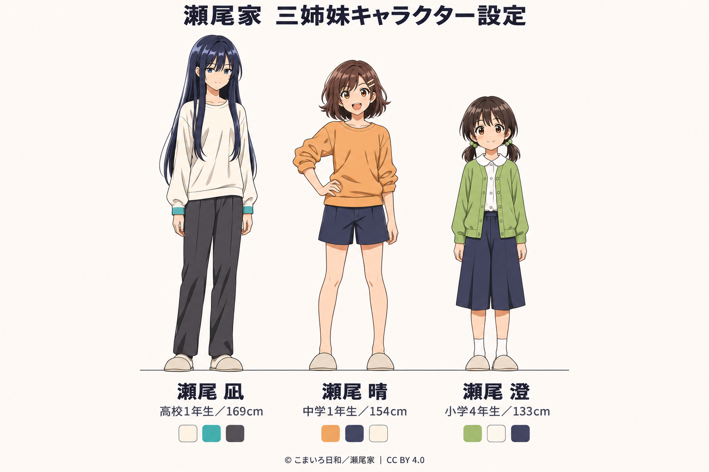
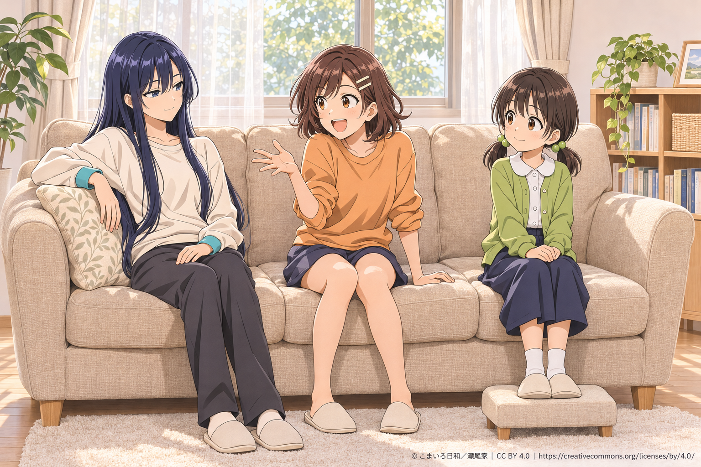
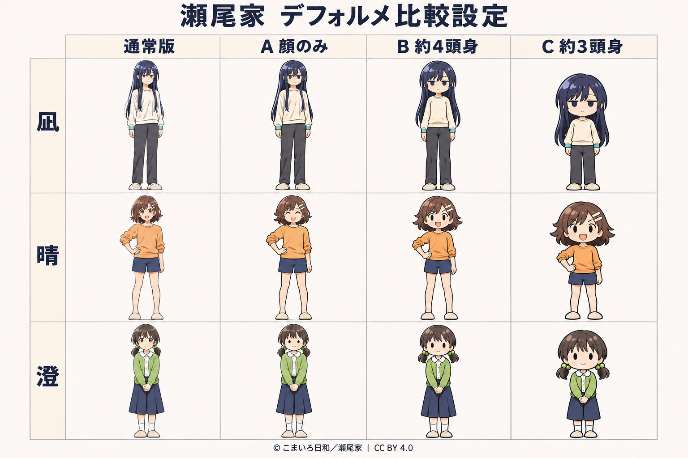
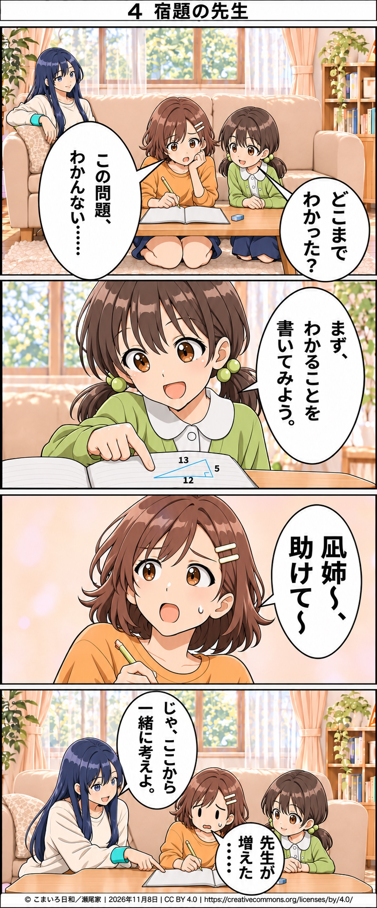

# 瀬尾家の設定と制作例

『瀬尾家』は、高校生・中学生・小学生の三姉妹の温かな日常を描く4コマ漫画です。『ためし部』と同一人物の瀬尾凪を軸に、晴の勢い、澄の真面目な反応、姉妹の立場の逆転から笑いを生みます。

## 人物と家庭での服装

| 人物 | 学年と身長 | 性格 | 外見と色 |
|---|---|---|---|
| 長女 瀬尾凪 | 高校1年、169cm | クールでマイペース、さりげなく妹を気遣う | 青黒の長い直毛、生成りトップスと青緑の袖口、チャコールのパンツ |
| 二女 瀬尾晴 | 中学1年、154cm | 自称三姉妹の中心、お調子者、立ち直りが早い | 茶の外はねボブ、本人左に平行ピン2本、杏色スウェット、紺ショートパンツ |
| 三女 瀬尾澄 | 小学4年、133cm | 真面目で優秀、礼儀正しく年相応に甘える | 低い二つ結び、若草色の丸い髪留め、白丸襟と若草色カーディガン、紺キュロット |

基準色は凪 #43B5B0、晴 #EAA15B、澄 #99BC76です。凪は妹を「晴」「澄」、晴は「凪姉」「澄」、澄は「凪お姉ちゃん」「晴お姉ちゃん」と呼びます。

『ためし部』の折原すみれと、瀬尾家の澄は別人です。凪の家庭内の服装を学校の制服へ混ぜず、晴の平行ピン2本とこよみの長方形ピン1本も区別します。

## 背景を人物の行動へつなげる

同じソファで、凪は肩を落としてくつろぎ、晴は前のめりで元気に話し、澄は姿勢よく座ります。人物が座る位置、家具、窓、小物の配置を[リビングの実使用指示](prompts/リビング_制作プロンプト.txt)で共有しています。背景をそろえるだけでなく、座り方で性格を見せる資料です。

## 通常とギャグの比較

通常を基本に、Aは顔だけ、Bは約4頭身、Cは約3頭身です。比較画像の表示や旧プロンプトに旧案が残っていても、最新の[ギャグ作画設定](gag-policy.txt)を優先します。笑いがあるコマでも通常版で表現できる場合は通常版を使い、一人だけ表情を変えることもできます。

人物別に通常表情とA案を参照できます。[凪 通常](assets/nagi-expressions.png)・[凪 A](assets/nagi-expressions_A.png)、[晴 通常](assets/haru-expressions.png)・[晴 A](assets/haru-expressions_A.png)、[澄 通常](assets/sumi-expressions.png)・[澄 A](assets/sumi-expressions_A.png)。

## 追加の制作例 宿題の先生

晴が宿題を澄に相談し、凪も一緒に考える4コマです。元チャットで最新版として明示されたv12を収録しました。最終コマの晴だけA案、凪と澄は通常のデザインです。

| コマ | 発言順とセリフ | 画面と文字の要点 |
|---|---|---|
| 1 | 晴「この問題、わかんない……」→澄「どこまでわかった？」 | 晴を左下、澄を右下に置き、高さで晴が先と示す。通常会話の字の大きさはそろえる |
| 2 | 澄「まず、わかることを書いてみよう。」 | 澄とノートを見せる |
| 3 | 晴「凪姉〜、助けて〜」 | 助けを求める声を意図的に大きくする |
| 4 | 凪「じゃ、ここから一緒に考えよ。」→晴「先生が増えた……」 | 晴のセリフは「先生が／増えた／……」の3列。手とノートを隠さない |

[v11](assets/homework-v11.jpg)と[最新作画方針の実使用指示](prompts/宿題の先生_最新作画方針_制作プロンプト.txt)を対応させて確認できます。すべての途中修正を一本の生成指示とみなさず、最終稿と修正条件を併せて読みます。

[レイアウト修正v7](prompts/宿題の先生_レイアウト修正v7プロンプト.txt)は、1コマ目の吹き出しの高さと「ま」の余分な横線を修正した指示です。このv7指示だけでv12全体を再現できるわけではありません。

## 全6本の最新版と扱い

元チャットの指定は、三姉妹の中心v2、最後のアイスv2、お風呂の順番v6、宿題の先生v12、休日の予定v2、しっかり者のお願いv2です。このパッケージは設定資料と「宿題の先生」を選んで収録し、全6本の画像は収録していません。

本文6本の確認記録と、表紙・投稿の準備は別です。元チャットの最新共有文では表紙と投稿予定は未確定です。この追加作業で表紙制作や投稿は行っていません。

## 共通手順へ取り込んだこと

線とセル塗りの安定、資料の役割分担、少量のギャグ表現、文字を別に組む方法、吹き出しの高さでの発言順、修正後の全体確認を[共通手順](../../docs/color-workflow.md)へ反映しました。家族関係と普段着はこの作品にだけ適用します。

## 完成画像の配布

このフォルダーは解説用の抜粋です。最新版の本文全6回は、この制作資料リポジトリのGitHub Releaseへ画像一式として公開予定です。[公開計画](../../releases/README.md)に対象版を列挙しています。表紙はこの6枚に含みません。ライセンスは[CC BY 4.0](../../LICENSE.md)です。
