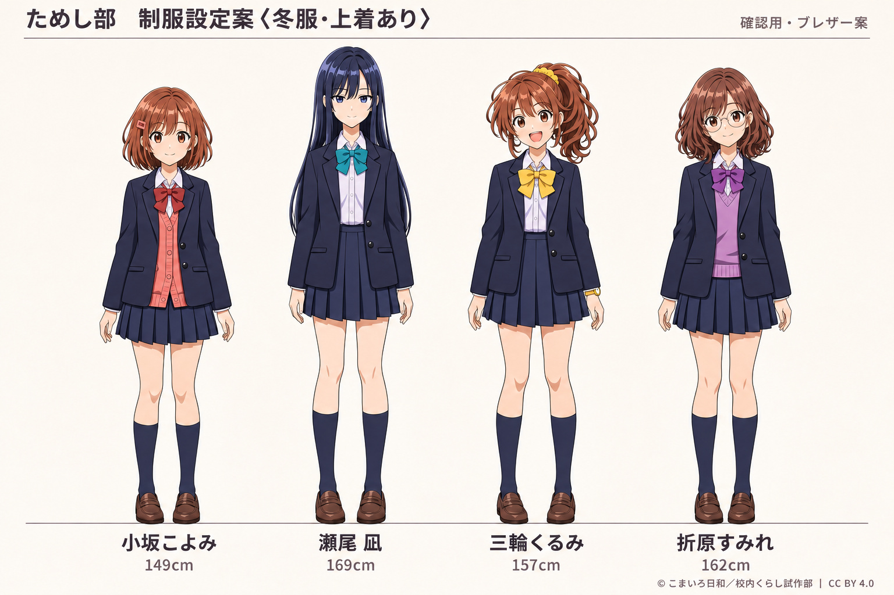
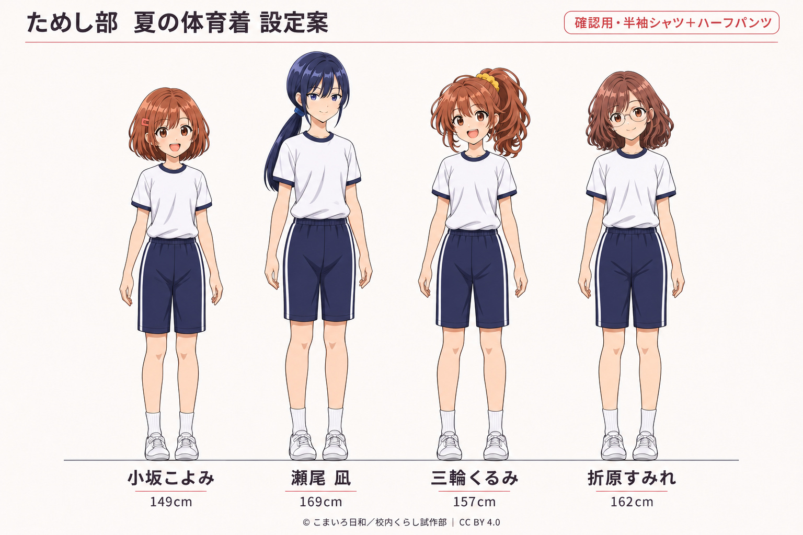

# ためし部 衣装設定6案と4人の最新設定

**2026年11月18日、全6案をユーザーが採用済みです。** 4人の顔・体格・性格・役割・表情は既存設定を維持し、季節と用途ごとの衣装を追加します。

画像に残る「設定案」「確認用」、制作メモの「未採用」「ブレザー未設定」は制作途中の表示です。画像と要約記録は変更せず保持し、現在の採用状態は[採用台帳](adopted.json)と[最新設定JSON](character-settings.json)を正とします。既存原稿や公開済みプロフィールへ遡って差し替える指示ではありません。

## pixiv公開状態（2026年11月25日確認）

夏服の[pixiv公開作品](https://www.pixiv.net/artworks/152359656)を、ユーザー提供URLと作品対応の明示確認に基づき反映しました。[画像付きX告知](https://x.com/komairo_hiyori/status/2124430280627016049)は同日18:10 JSTに完了し、担当チャットの個別URL・画像リンク確認記録があります。pixiv本体は直接確認しておらず、実際の公開時刻は未検証です。11月22日時点では夏服のみ公開完了を確認していました。

夏服JPEGは既存収録画像と採用元がバイト単位で一致しました。制作方法は[制作メモとプロンプト](production-notes/制作メモとプロンプト.txt)の共通指示と夏服案で説明しています。これは要約記録で実使用全文ではありません。メモ中の未採用・未投稿は制作時点の履歴です。[公開記録](../../../releases/pixiv-publication-status.md)も参照してください。衣装資料のGitHub収録とpixiv投稿完了、新しい画像Releaseの有無は分けて管理します。

冬服・室内の[pixiv公開作品](https://www.pixiv.net/artworks/152401916)も、11月23日のユーザー提供URLと「第3回、冬服」の対応確認に基づき追加しました。JPEGは既存収録画像と採用元がバイト単位で一致しています。[画像付きX告知](https://x.com/komairo_hiyori/status/2124794466385137917)は11月23日18:17 JSTに完了し、担当チャットの採用JPEGプレビュー・本文URL・送信後の個別ポストURLと画像リンクの確認記録を反映しました。制作方法は上記要約メモの共通指示と冬服案を参照し、ブレザーなしの室内服と、後から追加したブレザー付き設定を区別します。11月23日時点では夏服と冬服室内の2案を確認済みでした。

冬服（ブレザー）の[pixiv公開作品](https://www.pixiv.net/artworks/152439492)と[画像付きX告知](https://x.com/komairo_hiyori/status/2125158444579918316)を11月24日に追加しました。pixivはユーザー提供URLと作品対応の明示確認、Xは同日18:24 JSTの担当チャットのJPEGプレビュー・本文URL・送信後の個別URLと画像リンク確認が根拠です。JPEGは採用元と既存収録画像にバイト単位で一致しました。

制作方法は[冬服上着ありの制作指示要約](production-notes/冬服上着あり_制作指示.txt)を参照します。冬服室内を参照して紺のシングル2ボタンブレザーを加え、各人のリボン・インナー・識別要素を維持した版です。これは実使用全文ではなく要約記録です。11月24日時点では夏服・冬服室内・ブレザーの3案を確認済みでした。既存画像や制作原文は変更していません。

冬の外出着の[pixiv公開作品](https://www.pixiv.net/artworks/152475453)と[画像付きX告知](https://x.com/komairo_hiyori/status/2125520454366744752)を11月25日に追加しました。pixivはユーザー提供URLと作品対応確認、Xは同日18:22 JSTの担当チャットによる採用JPEG・本文URL・個別ポストURL・画像リンク確認記録が根拠です。JPEGは既存収録画像と採用元にバイト単位で一致しました。

[冬の外出着の制作指示要約](production-notes/冬の外出着_制作指示.txt)に、冬服ブレザーの上へ4人それぞれのコート・マフラーを重ねる指示があります。人物識別・身長差を維持し、不透明タイツと茶ローファー、コート下に見える制服の裾をそろえています。この資料は実使用全文ではなく要約記録です。体育用ジャージ・夏の体育着2案のpixiv公開完了は未確認です。既存画像・制作記録は変更していません。

## 採用した6案

| 設定 | 用途 | JPEG | PNG |
|---|---|---|---|
| 夏服 | 夏の制服。こよみはカーディガンなし、すみれは薄手ベスト。 | [JPEG](assets/ためし部_制服設定案_夏服.jpg) | [PNG](assets/ためし部_制服設定案_夏服.png) |
| 冬服・室内 | 長袖の室内制服。こよみのカーディガン、すみれのベストを維持。 | [JPEG](assets/ためし部_制服設定案_冬服.jpg) | [PNG](assets/ためし部_制服設定案_冬服.png) |
| 冬服・ブレザー | 共通の紺シングル2ボタンブレザー。前を開きリボンとインナーを見せる。 | [JPEG](assets/ためし部_制服設定案_冬服_上着あり.jpg) | [PNG](assets/ためし部_制服設定案_冬服_上着あり.png) |
| 冬の外出着 | 冬制服の上に個人別コートとマフラー。不透明タイツを着用。 | [JPEG](assets/ためし部_冬の外出着_設定案.jpg) | [PNG](assets/ためし部_冬の外出着_設定案.png) |
| 体育・長袖ジャージ | 学校共通の紺長袖ジャージと長ズボン。 | [JPEG](assets/ためし部_体育用トレーニングウェア_設定案.jpg) | [PNG](assets/ためし部_体育用トレーニングウェア_設定案.png) |
| 体育・夏用 | 白半袖シャツと紺ハーフパンツ。裾は入れる。 | [JPEG](assets/ためし部_夏の体育着_設定案.jpg) | [PNG](assets/ためし部_夏の体育着_設定案.png) |

制服のブレザーと、防寒用の外出コートは別の用途です。衣替えの日程は未設定で、作中の季節・場所に合わせて選びます。

## 4人の個別設定

| 人物 | 身長 | 制服・外出着 | 体育時 |
|---|---|---|---|
| 小坂こよみ | 149cm | えんじ色のリボン。夏はカーディガンなし、冬はコーラルのカーディガン。 キャメルのダッフルコート（3つのトグル、フードは下ろす）、コーラルのマフラー。 | 通常のボブと髪留めを維持。 |
| 瀬尾凪 | 169cm | ティールのリボン。夏は白半袖、冬は白長袖ブラウス。 チャコールグレーのシングルウールコート、ティールのマフラー。 | 体育時は長い髪を低い位置で束ねる。通常時の髪型を変更した扱いにはしない。 |
| 三輪くるみ | 157cm | 黄色のリボン、本人の左腕に黄色の時計。夏は白半袖、冬は白長袖ブラウス。 紺のピーコート、マスタード色のマフラー。 | 高いポニーテールと黄色のシュシュを維持。体育時は時計を外す。 |
| 折原すみれ | 162cm | 紫のリボン、ラベンダーのVネックベスト。夏は薄手ベストと白半袖、冬はベストと白長袖。 グレージュのシングルウールコート、ラベンダーのマフラー。 | ボブと丸眼鏡を維持。 |

凪の低いポニーテールは体育時だけで、通常の長いストレート髪は維持します。くるみは体育時に時計を外します。体育着では全員リボンと時計を着用せず、こよみの髪留め・すみれの眼鏡など人物固有の特徴は維持します。

[読みやすい設定本文](character-settings-20261118.txt)も収録しています。JSON・設定本文にある参照パスはリポジトリルート相対です。

## 制作メモの読み方

次の5本は**実際の生成プロンプト全文ではなく、制作指示の要約記録**です。過去の未採用表記はその時点の記録であり、採用台帳の代わりに使いません。

- [体育用トレーニングウェア_制作指示.txt](production-notes/体育用トレーニングウェア_制作指示.txt)
- [冬の外出着_制作指示.txt](production-notes/冬の外出着_制作指示.txt)
- [冬服上着あり_制作指示.txt](production-notes/冬服上着あり_制作指示.txt)
- [制作メモとプロンプト.txt](production-notes/制作メモとプロンプト.txt)
- [夏の体育着_制作指示.txt](production-notes/夏の体育着_制作指示.txt)

制作順は、既存の採用人物紹介4点 → 夏服・冬服 → 冬服ブレザー追加 → 冬の外出着、夏服 → 長袖ジャージ → 夏の体育着です。共通の接地線・立ち位置・身長差を保ち、衣装ごとに髪型や小物の例外を確認します。

## 収録と検証

設定画6案×JPEG/PNGの12ファイルを採用元から変更せず収録しました。[画像台帳](manifest.json)に各形式の寸法・容量・SHA-256を記録し、[検証結果](verification.json)で原本との一致と公開用パスを確認しています。衣装資料は今回の明示採用・公開依頼によりGitHubの制作資料へ追加したもので、pixiv投稿完了を示すものではありません。新しいReleaseは作成していません。

[ためし部の設定](../../tameshibu.md)・[CC BY 4.0](../../../LICENSE.md)。作者：こまいろ日和 / Komairo Hiyori。作画・編集に生成AIを使用しています。

### 夏服

### 冬服・室内

### 冬服・ブレザー

### 冬の外出着

### 体育・長袖ジャージ

### 体育・夏用

